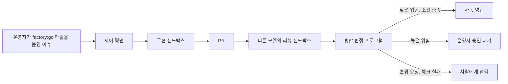

# Software Factory

GitHub 이슈를 AI 에이전트가 구현하고, 다른 모델이 리뷰하고, 프로그램이 병합 여부를 판정하는 소프트웨어 팩토리 플랫폼이다. 여러 저장소를 하나의 제어 평면에서 관리한다. 사람은 포털에서 진행 상황을 보고, 위험한 변경만 직접 판단한다.

| 주소                                                        | 내용                                                                                         |
| ----------------------------------------------------------- | -------------------------------------------------------------------------------------------- |
| [소개 페이지](https://roboco.io/the-software-factory-demo/) | 로그인 없이 읽는 플랫폼 소개. GitHub Pages로 배포한다.                                       |
| [포털](https://software-factory-control.roboco.workers.dev) | 프로젝트 목록, 실행 흐름과 재생, 예산 상태. 운영자는 실행 중지, 승인, 예산 한도 변경을 한다. |
| [conveyor](https://roboco.io/conveyor/)                     | 팩토리가 관리하는 예제 포럼 앱.                                                              |
| [책](https://github.com/roboco-io/the-software-factory)     | 이 플랫폼의 바탕이 된 생각을 정리한 책.                                                      |

## 동작 방식



운영자가 관리 대상 저장소의 이슈에 `factory:go` 라벨을 붙이면 실행이 시작된다. GitHub App(`roboco-software-factory-control`)이 이 이벤트를 제어 평면으로 보낸다. 제어 평면은 웹훅 서명, 라벨을 붙인 사람이 운영자인지(`OPERATOR_IDS`), 저장소가 등록된 프로젝트인지(`PROJECTS`)를 확인한 뒤 실행을 만든다. 그 뒤 Cloudflare Sandbox 컨테이너에서 에이전트가 코드를 고치고, 제어 평면이 그 변경으로 PR을 연다.

병합 여부는 에이전트가 정하지 않는다. 프로그램이 다음 네 가지를 읽어 판정한다.

- 대상 저장소 기본 브랜치의 `.factory/policy.yml`. 파일 경로별 위험 등급, 필수 체크, 자동 병합 등급이 들어 있다.
- GitHub의 체크 결과
- 리뷰 모델의 판정
- 운영자의 PR 승인

T0-T2는 정책이 허용하고 체크와 리뷰를 통과하면 자동으로 병합된다. T3은 정책 파일이 허용해도 항상 사람의 승인을 기다린다. `.github/`와 `.factory/` 아래 파일은 정책과 관계없이 T3 이상이다. 정책 파일 예시는 [docs/examples/factory-policy.yml](docs/examples/factory-policy.yml)에 있다.

### 엔진과 예산

| 역할 | 기본                                  | Anthropic 예산이 부족할 때                 |
| ---- | ------------------------------------- | ------------------------------------------ |
| 구현 | Claude Code, `claude-sonnet-5-5`      | pi, `gpt-6.1-terra`                        |
| 리뷰 | pi, `gpt-5.4-nano` (구현과 다른 계정) | pi, 구현과 같은 계정의 다른 모델 (T0-T1만) |

Anthropic과 OpenAI 계정에는 각각 월 $50 상한이 있다. 실행 하나에는 단계마다 $5 상한이 있다. 지출은 잔액 API가 아니라 호출마다 기록한 토큰 수로 계산한 추정치다. 한 계정만 남으면 T2-T3 변경은 리뷰를 기다린다. 두 계정이 모두 상한에 도달하면 새 실행을 멈추고 포털에 안내를 표시한다. 자세한 규칙은 [설계 문서](docs/design.md)의 5절과 "5단계 구현 상태"에 있다.

### 보안 원칙

컨테이너에는 GitHub 토큰과 LLM API 키를 넣지 않는다. 체크아웃과 PR 생성은 제어 평면이 처리한다. LLM 호출은 출구 핸들러를 거친다. 이 핸들러가 키를 넣고, 허용된 호스트와 요청 형식만 통과시킨다. 그래서 에이전트가 이슈 본문 등을 통해 인젝션 공격을 당해도 비밀을 얻을 수 없다. 포털과 실행 기록에는 에이전트의 원문 출력을 남기지 않고, 고정된 사유 코드만 남긴다.

## 진행 상태

<!-- status:begin -->
<!-- prettier-ignore-start -->

2026-11-14 기준이다. 이 표는 `docs/status.json`에서 생성한다.

| 단계 | 내용 | 상태 |
| --- | --- | --- |
| 0. 실험 | Sandbox SDK에서 에이전트 실행, 출구 제한, 키 주입 | 완료 |
| 1. 저장소 기반 | 모노레포, CI, 배포 | 완료 |
| 2. 한 이슈 전체 경로 | 이슈에서 구현, PR까지와 이벤트 저장 | 완료 |
| 3. 리뷰와 병합 | 교차 리뷰, 위험 등급, 필수 체크, 사람 승인 | 완료. 체크 실패, 승인 뒤 헤드 변경, 비공개 저장소 경로는 실서비스 확인이 남았다 |
| 4. 포털과 인증 | 로그인, 역할, 실행 조회, 중지, 승인, 비용 표시 | 완료. 포털에서 하는 승인과 한도 변경 폼은 실서비스 확인이 남았다 |
| 5. 예산과 전환 | 지출 계산, 엔진 전환, 소진 안내, 한도 변경 | 완료. 추정 지출과 실제 청구액의 대조가 남았다 |
| 6. conveyor 이전 | conveyor를 프로젝트로 등록하고 실제 이슈 처리 | 완료. 실제 이슈 1건으로 확인했다 |
| 7. 샌드박스 공개 | 게스트 요청의 심사와 공개 조건 시험, 공개 | 진행 중. 공개 형태를 게스트 데모 방식으로 정했다. 전체 중지와 심사의 사전 검사·판정 검사 코드는 있으나 웹훅에 연결하지 않아 게스트 요청은 아직 처리되지 않는다 |
| 8. 책 개정 | 새 구조에 맞춰 책을 고침 | 미착수 |

<!-- prettier-ignore-end -->
<!-- status:end -->

진행 상태, 실서비스에서 확인한 것과 남은 확인 항목, 다음 작업은 [현재 상태 문서](docs/status.md)에 있다. 그 문서와 위 표는 `docs/status.json`에서 생성하며, 다른 문서는 상태를 따로 적지 않는다. 단계별 설계와 완료 조건은 [설계 문서](docs/design.md)의 7절에 있다.

## 저장소 구조

| 경로           | 내용                                                                                                                                                   |
| -------------- | ------------------------------------------------------------------------------------------------------------------------------------------------------ |
| `apps/control` | 제어 평면 Cloudflare Worker. API와 포털 정적 파일을 함께 제공한다. D1에 실행 기록을 저장하고, 이슈마다 하나인 Durable Object가 상태 전환을 직렬화한다. |
| `apps/portal`  | 포털 웹앱. Vite로 빌드하며, 빌드 결과를 `apps/control`이 제공한다.                                                                                     |
| `apps/site`    | GitHub Pages 소개 페이지. 예전 conveyor 주소로 들어온 방문자를 `/conveyor/`로 넘기는 스크립트도 들어 있다.                                             |
| `docs`         | 설계 문서(`design.md`), 운영 문서(`operations.md`), 게스트 데모 기획(`guest-demo.md`), 정책 파일 예시.                                                 |
| `experiments`  | 일회성 실험. 제품 코드가 의존하지 않으며 pnpm 워크스페이스에 포함하지 않는다.                                                                          |

## 개발

Node.js 24 이상과 pnpm 10이 필요하다.

```bash
pnpm install
```

```bash
pnpm check
```

`pnpm check`는 포맷, 린트, 타입, 시험, 빌드를 모두 검사한다. CI도 같은 명령을 실행한다. 로컬에서 실행하려면 포털을 빌드한 뒤 Worker를 띄운다.

```bash
pnpm --filter @factory/portal build
```

```bash
pnpm --filter @factory/control dev
```

## 배포와 운영

`main`에는 보호 규칙(`main-protection`)이 있어서, PR과 `check` 통과 없이는 병합할 수 없다. `main`에 병합하면 `deploy` 워크플로가 D1 마이그레이션을 적용하고 Worker와 포털을 배포한다. `apps/site/public`이 바뀌면 `pages` 워크플로가 소개 페이지를 배포한다.

비밀 값, 변수, GitHub App과 OAuth App 설정, 예산 설정은 [운영 문서](docs/operations.md)에 있다. 실서비스 확인 여부는 [현재 상태 문서](docs/status.md)에 있다. 값을 설정하기 전에도 배포는 가능하다. 다만 `RUNS_ENABLED`가 `true`가 아니면 실행이 시작되지 않는다.

새 프로젝트를 관리하려면 다음 세 가지가 필요하다.

1. GitHub App을 그 저장소에 설치한다.
2. 저장소 기본 브랜치에 `.factory/policy.yml`을 둔다.
3. `apps/control/wrangler.jsonc`의 `PROJECTS`에 저장소를 더한다.

읽기 API는 익명에게도 열려 있다. 그래서 `PROJECTS`에는 공개 저장소만 넣는다.

기여 규칙은 [AGENTS.md](AGENTS.md)에 있다.
