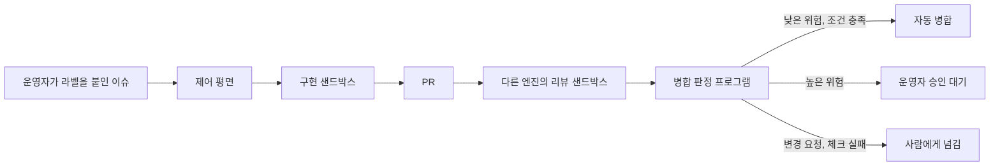

# Software Factory

GitHub 이슈를 AI 에이전트가 구현하고, 다른 엔진이 리뷰하고, 프로그램이 병합 여부를 판정하는 소프트웨어 팩토리 플랫폼이다. 여러 저장소를 하나의 제어 평면에서 관리하며, 사람은 포털에서 진행 상황을 보고 위험한 변경을 직접 판단한다.

## 동작 방식



병합 여부는 에이전트가 정하지 않는다. 프로그램이 대상 저장소 기본 브랜치의 `.factory/policy.yml`(위험 등급 규칙, 필수 체크, 자동 병합 등급)과 GitHub의 체크 결과, 운영자의 PR 승인을 읽어 판정한다. 위험 등급 T0는 조건이 맞으면 자동으로 병합되고, T3은 정책 파일이 허용해도 사람의 승인을 기다린다. 정책 파일 예시는 [docs/examples/factory-policy.yml](docs/examples/factory-policy.yml)에 있다.

컨테이너에는 GitHub 토큰과 LLM API 키를 넣지 않는다. 체크아웃과 PR 생성은 제어 평면이 처리하고, LLM 호출의 키는 출구 핸들러가 주입한다. 에이전트가 인젝션 공격을 당해도 비밀을 얻지 못하게 하기 위해서다.

## 진행 상태

| 단계                 | 내용                               | 상태                                                                                 |
| -------------------- | ---------------------------------- | ------------------------------------------------------------------------------------ |
| 0-2. 실험, 전체 경로 | 샌드박스 실험, 이슈에서 PR까지     | 구현됨                                                                               |
| 3. 리뷰와 병합       | 교차 리뷰, 위험 등급, 사람 승인    | 구현됨. 공개 시험 저장소에서 실제로 실행함                                           |
| 4. 포털과 인증       | 로그인, 역할, 실행 조회, 실행 중지 | 구현됨. 일부 항목은 실서비스에서 미확인([운영 문서](docs/operations.md)의 마지막 절) |
| 5. 예산과 전환       | 지출 계산, 엔진 전환               | 미구현                                                                               |
| 6-8                  | conveyor 이전, 샌드박스 공개, 책   | 미구현                                                                               |

단계별 설명과 완료 조건은 [설계 문서](docs/design.md)의 7절에 있다.

## 저장소 구조

- `apps/control`: 제어 평면 Cloudflare Worker. API와 포털 정적 파일을 함께 제공한다. D1에 실행 기록을 저장하고, 이슈마다 하나인 Durable Object가 상태 전환을 직렬화한다.
- `apps/portal`: 포털 웹앱. Vite로 빌드한다.
- `docs`: 설계 문서와 운영 문서.
- `experiments`: 일회성 실험. 제품 코드가 의존하지 않으며 pnpm 워크스페이스에 포함하지 않는다.

## 개발

Node.js 24 이상과 pnpm 10이 필요하다.

```bash
pnpm install
```

```bash
pnpm check
```

`pnpm check`는 포맷, 린트, 타입, 시험, 빌드를 모두 검사한다. 로컬에서 실행하려면 포털을 빌드한 뒤 Worker를 띄운다.

```bash
pnpm --filter @factory/portal build
```

```bash
pnpm --filter @factory/control dev
```

## 운영

비밀 값, 변수, GitHub App과 OAuth App 설정은 [운영 문서](docs/operations.md)에 있다. 값을 설정하기 전에도 배포는 가능하며, `RUNS_ENABLED`가 `true`가 아니면 실행이 시작되지 않는다. `main`에 푸시하면 `deploy` 워크플로가 실행된다.

기여 규칙은 [AGENTS.md](AGENTS.md)에 있다.
