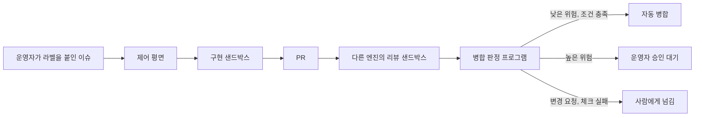

# Software Factory

GitHub 이슈를 AI 에이전트가 구현하고, 다른 엔진이 리뷰하고, 프로그램이 병합 여부를 판정하는 소프트웨어 팩토리 플랫폼이다. 여러 저장소를 하나의 제어 평면에서 관리하며, 사람은 포털에서 진행 상황을 보고 위험한 변경을 직접 판단한다.

## 동작 방식



병합 여부는 에이전트가 정하지 않는다. 프로그램이 대상 저장소 기본 브랜치의 `.factory/policy.yml`(위험 등급 규칙, 필수 체크, 자동 병합 등급)과 GitHub의 체크 결과, 운영자의 PR 승인을 읽어 판정한다. 정책 파일의 `autoMergeTiers`에 넣은 등급(예: T0)은 조건이 맞으면 자동으로 병합되고, 기본값으로 자동 병합되는 등급은 없다. T3은 정책 파일이 허용해도 사람의 승인을 기다린다. 정책 파일 예시는 [docs/examples/factory-policy.yml](docs/examples/factory-policy.yml)에 있다.

컨테이너에는 GitHub 토큰과 LLM API 키를 넣지 않는다. 컨테이너는 대상 저장소를 토큰 없이 읽기 전용으로 복제한다. 출구 핸들러가 GitHub 요청에 키를 넣지 않으므로 대상 저장소는 공개 저장소여야 한다. 브랜치, 커밋, PR 생성은 제어 평면이 GitHub App 토큰으로 처리하고, LLM 호출의 키는 출구 핸들러가 주입한다. 에이전트가 인젝션 공격을 당해도 비밀을 얻지 못하게 하기 위해서다.

## 진행 상태

| 단계                 | 내용                               | 상태                                                                                 |
| -------------------- | ---------------------------------- | ------------------------------------------------------------------------------------ |
| 0-2. 실험, 전체 경로 | 샌드박스 실험, 이슈에서 PR까지     | 구현됨                                                                               |
| 3. 리뷰와 병합       | 교차 리뷰, 위험 등급, 사람 승인    | 구현됨. 공개 시험 저장소에서 실제로 실행함                                           |
| 4. 포털과 인증       | 로그인, 역할, 실행 조회, 실행 중지 | 구현됨. 일부 항목은 실서비스에서 미확인([운영 문서](docs/operations.md)의 마지막 절) |
| 5. 예산과 전환       | 지출 계산, 엔진 전환               | 미구현                                                                               |
| 6-8                  | conveyor 이전, 샌드박스 공개, 책   | 미구현                                                                               |

단계별 설명과 완료 조건은 [설계 문서](docs/design.md)의 7절에 있다.

## 저장소 구조

각 디렉터리의 README는 공개 인터페이스, 지켜야 할 불변 조건, 부수 효과를 코드 기준으로 정리한 계약 문서다.

- `apps`: [apps/README.md](apps/README.md) - 제품 앱 두 개를 묶는다.
  - `apps/control`: [apps/control/README.md](apps/control/README.md) - 제어 평면 Cloudflare Worker. API와 포털 정적 파일을 함께 제공한다. D1에 실행 기록을 저장하고, 이슈마다 하나인 Durable Object가 상태 전환을 직렬화한다. 소스 계약은 [apps/control/src/README.md](apps/control/src/README.md), D1 스키마는 [apps/control/migrations/README.md](apps/control/migrations/README.md)에 있다.
  - `apps/portal`: [apps/portal/README.md](apps/portal/README.md) - 포털 웹앱. Vite로 빌드한다. 소스 계약은 [apps/portal/src/README.md](apps/portal/src/README.md)에 있다.
- `docs`: 설계 문서와 운영 문서.
- `experiments`: [experiments/README.md](experiments/README.md) - 일회성 실험. 제품 코드가 의존하지 않으며 pnpm 워크스페이스에 포함하지 않는다.

## 전역 불변 조건

다음 조건은 여러 컴포넌트에 걸쳐 있으므로, 한 곳을 고칠 때 다른 곳의 계약도 함께 확인해야 한다.

- 실행은 다음 조건을 모두 만족할 때만 시작한다. 서명이 유효한 `issues/labeled` 웹훅이 `factory:go` 라벨을 담는다. 보낸 사람이 봇이 아니고 `OPERATOR_IDS`에 있다. 저장소가 `PROJECTS`에 있다. 이슈가 열려 있고 PR이 아니다. `X-GitHub-Delivery` 값이 유효하고 처음 받은 값이다. 활성 실행 용량이 남아 있다. `RUNS_ENABLED`가 정확히 `"true"`다(`apps/control/src/routes.ts:53`, `apps/control/src/webhook.ts`). `ANTHROPIC_API_KEY`, `GITHUB_APP_ID`, `GITHUB_APP_PRIVATE_KEY`가 없으면 웹훅은 500을 반환하고 delivery id를 되돌려 재전송을 받을 수 있게 한다.
- 실행 상태는 `apps/control/src/run-state.ts`의 전환표가 허용하는 전환만 따르며, D1의 `runs.state` CHECK 제약(`apps/control/migrations`)과 일치해야 한다. `events` 테이블은 트리거로 수정과 삭제를 막는 추가 전용 기록이다.
- 병합은 `decideMerge`가 판정한다. T3 변경은 자동 병합하지 않으며, 병합은 리뷰한 `headSha`에 고정한 squash 병합이다.
- 컨테이너는 `enableInternet:false`로 시작하고, 모든 출구 요청은 `Outbound`의 허용 목록을 통과해야 한다. 구현 단계는 Anthropic만, 리뷰 단계는 OpenAI만 호출할 수 있다. GitHub는 바인딩된 저장소의 `git-upload-pack`(읽기)만 허용한다. URL에 자격 증명이나 기본이 아닌 포트가 있으면 거부한다. LLM 요청은 본문을 검사하고 모델을 실행 모델로 고정한다(`apps/control/src/outbound-policy.ts`, `apps/control/src/outbound-body.ts`). 컨테이너에는 자리표시 키만 있고, 실제 LLM 키는 `Outbound`가 주입한다. GitHub 토큰은 컨테이너에 들어가지 않는다.
- 조회 GET 라우트는 익명 사용자도 호출할 수 있다. 옵저버가 호출할 수 있는 쓰기 라우트는 자기 세션만 지우는 `POST /api/auth/logout`뿐이며, 실행을 바꾸는 라우트(중지, 승인)는 operator만 호출할 수 있다. 포털의 버튼 표시 조건은 화면상의 제한이며, 권한은 `apps/control`의 라우트 표가 강제한다.

## 전역 부수 효과

- Cloudflare: Worker `software-factory-control`과 포털 정적 자산, D1 데이터베이스 `software-factory`(`runs`, `events`, `deliveries`, `run_usage`), Durable Object `ISSUE_RUN`과 `SANDBOX`, `apps/control/container/Dockerfile`로 만든 컨테이너 이미지.
- GitHub: 브랜치, 커밋, PR, 이슈와 PR 댓글, squash 병합. 운영자 리뷰는 운영자 본인의 OAuth 토큰으로 게시한다.
- LLM: Anthropic(구현 단계)과 OpenAI(리뷰 단계) 호출. 토큰 사용량은 D1 `run_usage`에 최선 노력으로 기록한다. 실행 id, 단계, 모델, `DB` 중 하나가 없으면 기록을 건너뛰고, 기록 오류는 LLM 응답에 영향을 주지 않는다.

## 개발

Node.js 24 이상과 pnpm 10이 필요하다.

```bash
pnpm install
```

```bash
pnpm check
```

`pnpm check`는 포맷, 린트, 타입, 시험, 빌드를 모두 검사한다. 로컬에서 실행하려면 포털을 빌드한 뒤 Worker를 띄운다.

```bash
pnpm --filter @factory/portal build
```

```bash
pnpm --filter @factory/control dev
```

## 운영

비밀 값, 변수, GitHub App과 OAuth App 설정은 [운영 문서](docs/operations.md)에 있다. `wrangler.jsonc`가 `secrets.required`를 두지 않으므로 비밀 값을 설정하기 전에도 배포는 가능하다. `RUNS_ENABLED`가 정확히 `"true"`가 아니거나 `OPERATOR_IDS`, `PROJECTS`가 비어 있으면 실행이 시작되지 않는다. 현재 커밋된 `wrangler.jsonc`는 `RUNS_ENABLED`를 `"true"`로 두므로, 비밀 값 없이 배포한 상태에서 조건을 갖춘 웹훅이 오면 실행을 시작하지 못하고 500을 반환한다. `main`에 푸시하면 `deploy` 워크플로가 실행된다.

기여 규칙은 [AGENTS.md](AGENTS.md)에 있다.
