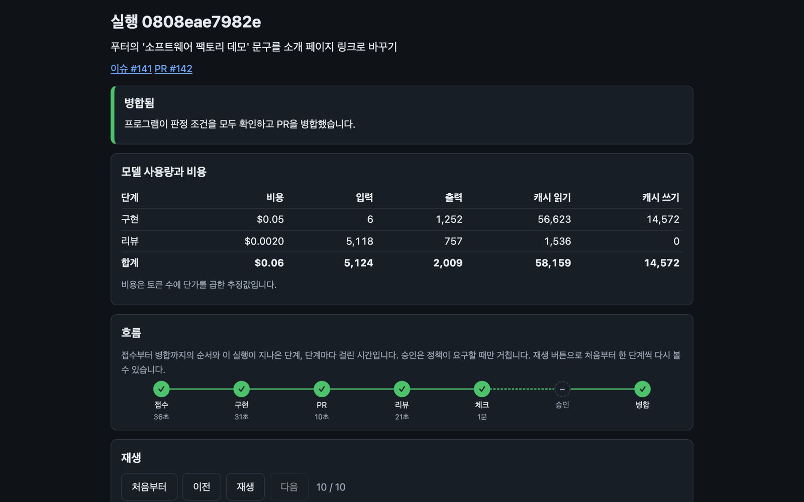
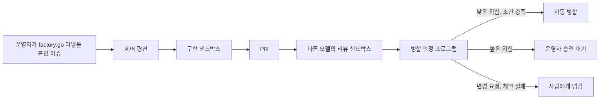

# Software Factory

책 [『The Software Factory』](https://factory.roboco.io)의 공통 구현 예제다. 책은 AI 에이전트에게 소프트웨어 개발을 맡길 때 필요한 원칙을 설명하고, 이 저장소는 그 원칙이 실제 서비스에서 어떻게 동작하는지 보여 준다. 책은 공개 초안이다.

이 플랫폼은 GitHub 이슈를 받아 AI 에이전트가 구현하고, 다른 회사의 모델이 리뷰하고, 프로그램이 병합 여부를 판정한다. 사람은 포털에서 진행 과정을 보고, 위험한 변경만 직접 판단한다.

[](https://software-factory-control.roboco.workers.dev/runs/0808eae7982e)

위 그림은 운영자가 이슈에 라벨을 붙인 뒤 사람의 개입 없이 병합된 [실제 실행](https://software-factory-control.roboco.workers.dev/runs/0808eae7982e)이다. 로그인하지 않아도 포털에서 모든 실행의 단계, 걸린 시간, 비용을 볼 수 있고, "재생" 버튼으로 처음부터 한 단계씩 다시 볼 수 있다.

| 주소                                                        | 내용                                                    |
| ----------------------------------------------------------- | ------------------------------------------------------- |
| [포털](https://software-factory-control.roboco.workers.dev) | 프로젝트 목록, 실행별 흐름과 재생, 예산 상태.           |
| [소개 페이지](https://roboco.io/the-software-factory-demo/) | 로그인 없이 읽는 플랫폼 소개.                           |
| [conveyor](https://roboco.io/conveyor/)                     | 이 플랫폼이 관리하는 예제 포럼 앱.                      |
| [책의 데모 해설](https://factory.roboco.io/demo/)           | 책이 이 플랫폼의 각 부분을 어떤 원칙과 연결하는지 설명. |

## 동작 방식



**시작.** 운영자가 관리 대상 저장소의 이슈에 `factory:go` 라벨을 붙이면 실행이 시작된다. 운영자는 설정에 GitHub 사용자 ID가 등록된 사람이다. 다른 사람이나 봇이 붙인 라벨은 무시한다. 이 요청을 받는 것은 제어 평면이다. 제어 평면은 실행의 시작, 상태 기록, PR 생성, 병합 판정을 맡는 Cloudflare Worker(`apps/control`)다.

**구현과 리뷰.** 에이전트는 인터넷 없이 시작하는 격리된 컨테이너(샌드박스)에서 코드를 고치고, 제어 평면이 그 변경으로 PR을 연다. 그 뒤 다른 회사의 모델이 별도의 샌드박스에서 PR을 리뷰한다. 구현은 Anthropic의 모델이, 리뷰는 OpenAI의 모델이 맡는다. 자기가 쓴 코드를 같은 모델이 승인하지 않게 하기 위해서다.

**병합 판정.** 병합 여부는 에이전트가 정하지 않는다. 프로그램이 네 가지를 읽어 판정한다. 대상 저장소의 정책 파일(`.factory/policy.yml`), GitHub의 체크 결과, 리뷰 모델의 판정, 운영자의 PR 승인이다. 정책 파일은 파일 경로마다 위험 등급을 T0(가장 낮음)부터 T3(가장 높음)까지 정하고, 어느 등급까지 사람 없이 병합할지 정한다. T3 변경은 정책 파일이 허용해도 항상 운영자의 승인을 기다린다. 정책 파일 예시는 [docs/examples/factory-policy.yml](docs/examples/factory-policy.yml)에 있다.

**비밀 없는 샌드박스.** 컨테이너에는 GitHub 토큰과 LLM API 키를 넣지 않는다. 컨테이너는 대상 저장소를 토큰 없이 읽기만 하고, 브랜치와 PR은 제어 평면이 만든다. 컨테이너가 밖으로 보내는 모든 요청은 제어 평면의 출구 핸들러를 거친다. 출구 핸들러는 허용된 호스트와 요청 형식만 통과시키고, LLM 호출에 키를 넣는 프로그램이다. 그래서 이슈 본문에 숨긴 지시로 에이전트를 조종하는 공격(프롬프트 인젝션)이 성공해도 에이전트가 비밀을 얻을 수 없다. 이 구조를 실서비스에서 시험한 기록은 [DNS 유출 실험](experiments/dns-exfil/RESULTS.md)과 [인젝션 시험](experiments/injection/RESULTS.md)에 있다.

**사람의 역할.** 운영자는 포털에서 실행을 중지하고, 승인을 기다리는 PR을 승인하거나 수정을 요청하고, 예산 한도를 바꾸고, 팩토리 전체를 멈출 수 있다. 로그인만 한 사람(옵저버)과 익명 방문자는 읽기만 할 수 있다. 조작별 효과는 [운영 문서](docs/operations.md)의 "운영자가 하는 일" 절에 있다.

## 책의 원칙과 이 플랫폼

아래 대응은 [책의 데모 해설](https://factory.roboco.io/demo/)이 연결한 것이다. 책은 이 플랫폼을 원칙의 구현 사례로 다루며, 효과를 입증하는 사례로 다루지는 않는다.

| 책의 패턴                  | 뜻                                                      | 이 플랫폼의 구현                                                                                 |
| -------------------------- | ------------------------------------------------------- | ------------------------------------------------------------------------------------------------ |
| 정책과 계획의 분리 (P02)   | 지켜야 할 경계와 이번 작업의 방법을 따로 관리한다.      | 위험 등급과 자동 병합 범위는 정책 파일에 있고, 에이전트는 이 파일을 바꿀 수 없다.                |
| 증거 기반 완료 (P06)       | 완료 보고가 아니라 증거로 완료를 판단한다.              | 프로그램이 GitHub의 체크 결과를 읽고, 리뷰한 커밋과 병합할 커밋이 같은지 확인한다.               |
| 독립된 검증 (P07)          | 실행자와 다른 경로로 결과를 판정한다.                   | 구현한 모델과 다른 회사의 모델이 리뷰한다.                                                       |
| 실행 주체의 교체 (P09)     | 도구를 바꿔도 업무의 기준을 유지한다.                   | 한 계정이 예산 한도에 도달하면 다른 계정의 모델로 전환하고, 병합 기준은 그대로 적용한다.         |
| 범위가 정해진 자율성 (P10) | 자동으로 수행할 범위를 정하고, 그 밖은 사람이 판단한다. | T3 변경은 운영자 승인을 기다린다. 컨테이너에는 토큰과 키가 없다.                                 |
| 예외를 통한 개입 (P11)     | 모든 실행이 아니라 예외에만 사람이 개입한다.            | 조건을 채운 변경은 자동으로 병합되고, 승인 대기와 사람에게 넘긴 실행만 운영자의 판단을 기다린다. |
| 결정에 필요한 보고 (P12)   | 로그가 아니라 결정에 필요한 정보를 남긴다.              | 포털은 에이전트의 원문 출력 대신 실행의 단계, 고정된 사유 코드, 비용을 보여 준다.                |

## 켜져 있는 기능과 꺼져 있는 기능

실서비스에서 켜져 있는 기능은 다음과 같다.

- 운영자가 라벨을 붙인 이슈의 구현, 리뷰, 병합 판정. 관리 대상은 `roboco-io/factory-test-app`과 `roboco-io/conveyor`다.
- 포털의 실행 조회와 재생, 실행별 비용 표시.
- 운영자의 실행 중지, 승인과 수정 요청, 예산 한도 변경, 전체 중지.
- 계정별 월 예산과 엔진 전환. 엔진은 에이전트 프로그램과 모델의 조합이다. 한 계정이 한도에 도달하면 남은 계정의 엔진이 구현과 낮은 위험 등급(T0-T1)의 리뷰를 맡고, 두 계정이 모두 도달하면 새 실행을 멈춘다.

코드는 있지만 설정으로 꺼 둔 기능은 다음 두 가지다.

- **게스트 요청.** 운영자가 아닌 GitHub 사용자가 conveyor에 요청 이슈를 열면, 프로그램의 사전 검사와 모델의 심사를 거쳐 인용된 요청만 실행하는 기능이다. 실제 게스트 요청으로 심사 경로를 시험한 뒤에 켜기로 하고 2026-11-17에 접수를 닫았다. 설계는 [게스트 데모 기획](docs/guest-demo.md)에 있다.
- **Dependabot 보안 업데이트의 자동 병합.** 조건을 채운 패치 수준의 보안 업데이트 PR을 하루 한 번 점검해 병합하는 기능이다. 저장소의 의존성을 사람 없이 바꾸게 되므로 운영자가 저장소별로 승인해야 켜지며, 승인된 저장소가 아직 없다. 조건은 [운영 문서](docs/operations.md)의 같은 이름의 절에 있다.

## 진행 상태

<!-- status:begin -->
<!-- prettier-ignore-start -->

2026-11-17 기준이다. 이 표는 `docs/status.json`에서 생성한다. 단계마다 끝난 일과 남은 일은 [현재 상태 문서](docs/status.md)에 있다.

| 단계 | 내용 | 상태 |
| --- | --- | --- |
| 0. 실험 | Sandbox SDK에서 에이전트 실행, 출구 제한, 키 주입 | 완료 |
| 1. 저장소 기반 | 모노레포, CI, 배포 | 완료 |
| 2. 한 이슈 전체 경로 | 이슈에서 구현, PR까지와 이벤트 저장 | 완료 |
| 3. 리뷰와 병합 | 교차 리뷰, 위험 등급, 필수 체크, 사람 승인 | 완료 |
| 4. 포털과 인증 | 로그인, 역할, 실행 조회, 중지, 승인, 비용 표시 | 완료 |
| 5. 예산과 전환 | 지출 계산, 엔진 전환, 소진 안내, 한도 변경 | 완료 |
| 6. conveyor 이전 | conveyor를 프로젝트로 등록하고 실제 이슈 처리 | 완료 |
| 7. 샌드박스 공개 | 게스트 요청의 심사와 공개 조건 시험, 공개 | 진행 중 |
| 8. 책 개정 | 새 구조에 맞춰 책을 고침 | 미착수 |

<!-- prettier-ignore-end -->
<!-- status:end -->

단계별 설계와 완료 조건은 [설계 문서](docs/design.md)의 7절에 있다. 진행 상태의 원본은 `docs/status.json` 하나이며, 다른 문서는 상태를 따로 적지 않는다.

## 저장소 구조

| 경로           | 내용                                                                                          |
| -------------- | --------------------------------------------------------------------------------------------- |
| `apps/control` | 제어 평면 Cloudflare Worker. API와 포털 정적 파일을 함께 제공하고, D1에 실행 기록을 저장한다. |
| `apps/portal`  | 포털 웹앱. Vite로 빌드하며, 빌드 결과를 `apps/control`이 제공한다.                            |
| `apps/site`    | GitHub Pages로 배포하는 소개 페이지.                                                          |
| `docs`         | 설계, 운영, 게스트 데모 기획, 현재 상태 문서와 정책 파일 예시.                                |
| `scripts`      | `docs/status.json`에서 상태 문서와 이 README의 진행 상태 표를 만드는 스크립트.                |
| `experiments`  | 일회성 실험과 그 결과. 제품 코드가 의존하지 않는다.                                           |

## 개발

Node.js 24 이상과 pnpm 10이 필요하다.

```bash
pnpm install
```

```bash
pnpm check
```

`pnpm check`는 포맷, 문서 상태의 정렬, 린트, 타입, 시험, 빌드를 모두 검사한다. CI도 같은 명령을 실행한다. 로컬에서 실행하려면 포털을 빌드한 뒤 Worker를 띄운다.

```bash
pnpm --filter @factory/portal build
```

```bash
pnpm --filter @factory/control dev
```

진행 상태를 바꿀 때는 `docs/status.json`을 고친 뒤 `pnpm docs:status`로 생성물을 다시 만든다.

## 더 읽을 문서

- [설계 문서](docs/design.md): 구조, 역할별 권한, 예산, 구현 순서와 그 이유.
- [운영 문서](docs/operations.md): 비밀 값과 변수, 배포, 새 프로젝트 등록, 엔진 전환 규칙, 운영자의 조작.
- [현재 상태 문서](docs/status.md): 단계마다 끝난 일, 실서비스에서 확인한 것, 남은 일.
- [AGENTS.md](AGENTS.md): 기여 규칙.
