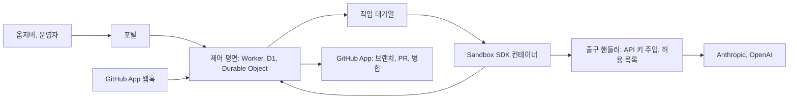

# 소프트웨어 팩토리 플랫폼 설계

작성일: 2026-11-06. 상태: 1-2단계 코드가 있고, 3단계(리뷰와 병합) 코드가 같은 날 추가되었다. 3단계는 가짜 GitHub, 가짜 샌드박스, 가짜 LLM으로만 시험했으며 실서비스에서 확인하지 않은 항목은 `docs/operations.md`의 마지막 절에 있다. 2026-11-07에 4단계의 일부(로그인, 역할, 읽기 API, 포털의 승인 버튼)와 5단계의 일부(모델 호출별 사용량 측정)가 추가되었다. 예산 상한, 모델 전환, 안내, 이슈 등록은 없다. 이 부분과 6단계 이후는 아직 제안이며 사용자의 확인을 기다린다.

## 1. 목적

이 플랫폼은 여러 저장소의 이슈를 AI 에이전트가 계획, 구현, 리뷰, 배포까지 처리하게 한다. 일반 사용자는 GitHub로 로그인한 옵저버로서 이 과정을 직관적으로 이해하고, 격리된 샌드박스에서 직접 요청해 체험한다.

이 저장소는 코드를 처음부터 새로 쓴다. 이전 저장소는 `roboco-io/conveyor`로 이름을 바꾸어 예제 서비스로 남겼다. 이전 프로젝트의 규칙, 훅, 스킬, 코드는 가져오지 않으며 전역 사용자 설정과 플러그인은 그대로 둔다. 이전 구현은 참고 자료로만 볼 수 있다.

## 2. 사용자가 정한 요구사항

사용자가 2026-11-06까지 정한 내용은 다음과 같다.

- 일반 사용자는 GitHub 인증으로 로그인하고 제한된 권한의 옵저버가 된다.
- 플랫폼은 rovr처럼 중앙 서버로 여러 프로젝트를 관리한다.
- 옵저버 요청은 샌드박스에서 사람 승인 없이 실행된다.
- 실행 환경은 Cloudflare Sandbox SDK다.
- 에이전트는 Claude Code 또는 Agent SDK와 pi이며, 각자의 API 키를 쓴다. Codex는 쓰지 않는다.
- 모델은 작업 내용에 따라 고를 수 있다.
- 계정별 사용량은 사용 가능량의 50%까지로 제한한다. Claude가 50%에 도달하면 pi로 전환한다. 둘 다 월간 50%에 도달하면 데모 사용자에게 안내하고 팩토리 이슈를 등록한다.
- conveyor는 별도 저장소의 관리 대상 프로젝트이며, 기존 URL은 유지하지 않아도 된다.
- 책 `roboco-io/the-software-factory`도 새 구조에 맞춰 개정한다.

## 3. 구조

제어 평면이 프로젝트, 이슈, 작업, 실행, 사용자, 사용량의 원본이다. Durable Object는 이슈마다 하나씩 두고 상태 전환을 직렬화한다. 여러 웹훅과 실행 결과가 동시에 들어와도 상태가 어긋나지 않게 하기 위해서다. 이전 구현은 GitHub 라벨을 상태 저장소로 썼는데, 라벨은 전환을 원자적으로 처리할 수 없고 화면을 만들기에도 불편했다. 이번에는 GitHub을 코드와 대화가 있는 곳으로만 쓴다.

컨테이너는 실행마다 새로 만들고, GitHub 토큰과 LLM API 키를 넣지 않는다. 체크아웃과 PR 생성은 제어 평면이 짧은 수명의 토큰을 범위를 좁혀 처리하고, LLM 호출은 출구 핸들러가 키를 주입한다. 에이전트가 인젝션 공격을 당해도 비밀을 얻지 못하게 하기 위해서다.

## 4. 흐름과 책임

한 이슈는 분류, 계획, 구현, 리뷰, 병합, 배포, 완료 검증의 순서로 진행한다. 각 단계의 결과는 구조화된 이벤트로 저장되며, 포털은 이 이벤트로 흐름과 판단 근거를 보여 준다. 구현과 리뷰는 기본적으로 서로 다른 엔진이 맡는다. 코드 변경의 병합 가능 여부는 에이전트가 아니라 프로그램이 위험 등급, 필수 체크, 리뷰 결과로 판정한다.

| 역할   | 조건               | 권한                                       |
| ------ | ------------------ | ------------------------------------------ |
| 익명   | 로그인 없음        | 소개와 공개 기록 재생                      |
| 옵저버 | GitHub 로그인      | 공개 프로젝트 열람, 샌드박스 요청(쿼터 안) |
| 운영자 | 관리자 목록에 있음 | 프로젝트 등록, 중지, 지시, 위험 변경 승인  |

옵저버 로그인은 사용자 식별에만 쓰며 GitHub 토큰을 저장하지 않는다. 옵저버 화면에는 에이전트 원문 로그와 비밀이 나타나지 않는다.

## 5. 예산

월 예산은 계정당 $50로 둔다. 2026-11-06 문서 조사에 따르면 Claude Max와 OpenAI Pro의 $100 구독에 월 $100 API 크레딧이 포함되고, 잔액을 읽는 공식 API는 찾지 못했다. 그래서 제어 평면이 호출별 사용량과 관리자 키의 사용 금액 API로 지출을 계산한다. 이 값은 추정치이며 청구 주기 경계에서 오차가 있다. 실행 전에 예상 비용을 예약하고, 출구 핸들러가 실행 중 상한을 넘는 호출을 막는다. Anthropic 전용 워크스페이스에는 지출 한도 $50을 안전장치로 건다.

두 계정이 모두 상한에 도달하면 새 실행을 멈추고, 포털에 안내를 표시하고, 청구 주기당 하나의 팩토리 이슈를 등록한다. 이 이슈는 예산을 쓰지 않도록 자동 처리 대상에서 뺀다. 한 엔진만 남으면 T0와 T1 변경은 다른 모델의 새 세션이 리뷰하고 그 사실을 표시한다. T2와 T3은 다른 엔진을 쓸 수 있을 때까지 기다린다.

## 6. 샌드박스 공개 조건

공개 입력을 승인 없이 실행하므로, 다음을 시험으로 확인하기 전에는 공개하지 않는다. 컨테이너에 비밀이 없고, 출구가 `Outbound` 코드의 호스트, 메서드, 경로 허용 목록으로 막히며, 다른 트래픽이 차단되고, DNS 이름 조회로 외부에 데이터가 나가지 않으며, 샌드박스 저장소에 다른 프로젝트 권한이나 프로덕션 연결이 없고, 계정별 및 전체 쿼터와 전체 중지가 동작해야 한다. 악용 신고와 신규 계정 제한, 그리고 공개 자동 실행이 GitHub과 LLM 제공자 정책에 맞는지는 공개 전에 사람이 확인한다.

## 7. 구현 순서

먼저 위험한 가정을 실험으로 확인한다. 그 뒤 얇은 전체 경로를 만들고, 기능은 그 위에 더한다.

| 단계                 | 내용                                                                           | 완료 조건                                                                                           |
| -------------------- | ------------------------------------------------------------------------------ | --------------------------------------------------------------------------------------------------- |
| 0. 실험              | Sandbox SDK에서 Claude와 pi 실행, 출구 제한, 키 주입, 실행 시간과 동시 실행 수 | 2026-11-06 실행함. 결과는 `experiments/sandbox-spike/RESULTS.md`에 있고, 미해결 항목은 8절에 적었다 |
| 1. 저장소 기반       | 새 AGENTS.md, 모노레포, CI, 배포                                               | 빈 포털과 Worker가 프로덕션에 배포된다                                                              |
| 2. 한 이슈 전체 경로 | 시험 저장소에서 이슈 → 구현 → PR까지, 이벤트 저장                              | 실제 이슈 하나가 PR이 된다                                                                          |
| 3. 리뷰와 병합       | 교차 리뷰, 위험 등급, 필수 체크, 사람 승인                                     | T0는 자동 병합되고 T3은 승인을 기다린다. 코드와 가짜 서비스 시험은 완료, 실서비스 확인은 남음       |
| 4. 포털과 인증       | OAuth, 역할, 프로젝트, 흐름, 재생                                              | 옵저버가 쓰기 작업을 할 수 없음을 API 시험이 증명한다. 로그인, 역할, 읽기 API, 승인 버튼은 구현됨   |
| 5. 예산과 전환       | 지출 계산, 전환, 안내, 이슈 등록                                               | 전환과 소진을 가짜 사용량으로 시험한다                                                              |
| 6. conveyor 이전     | conveyor를 프로젝트로 등록하고 배포, 완료 검증                                 | 실제 기능 이슈가 프로덕션까지 간다                                                                  |
| 7. 샌드박스 공개     | 6절의 조건을 시험하고 공개                                                     | 인젝션 시험 통과 뒤 사람이 공개를 승인한다                                                          |
| 8. 책 개정           | 새 구조에 맞춰 책을 고친다                                                     | 설명과 링크가 실제와 일치하고 사람이 검토한다                                                       |

### 3단계 구현 상태

3단계는 4절의 원칙을 다음과 같이 구현한다. PR이 열리면 구현과 다른 엔진(pi와 OpenAI의 `gpt-5.4-nano`, 변수 `REVIEW_MODEL`)이 새 샌드박스에서 읽기 전용으로 리뷰하고, 제어 평면이 리뷰 결과를 PR에 남긴다. 병합 여부는 프로그램이 대상 저장소 기본 브랜치의 `.factory/policy.yml`(위험 등급 규칙, 필수 체크, 자동 병합 등급)과 GitHub의 체크 실행, 운영자의 PR 승인으로 판정한다. T0는 조건이 맞으면 자동으로 병합되고, T3은 정책 파일이 허용해도 자동 병합하지 않으며 사람의 승인을 기다린다. `.github/`와 `.factory/` 아래 파일은 정책 규칙과 관계없이 최소 T3이다. 리뷰어가 변경을 요청하거나 결과가 유효하지 않으면 자동 수정 반복 없이 사람에게 넘긴다. 5절의 "한 엔진만 남은 경우"의 전환 규칙은 5단계에서 구현하므로 이번 단계에는 없다. 상세한 상태 전환, 사유 코드, 시간 제한은 `docs/operations.md`의 "리뷰와 병합 (3단계)" 절에 있다. 정책 파일 예시는 `docs/examples/factory-policy.yml`이다.

### 4단계와 5단계의 구현된 부분

2026-11-07에 제어 평면에 콘솔이 추가되었다. 구현한 것은 세 가지다. 첫째는 GitHub App 사용자 인증을 이용한 로그인과 역할이다. 로그인한 사람의 숫자 GitHub ID가 `OPERATOR_IDS`에 있으면 운영자이고, 없으면 옵저버다. 로그인은 8시간 유효한 서명 쿠키 세션을 만들며 GitHub 사용자 토큰은 저장하지 않는다. 둘째는 읽기 API와 포털이다. 로그인하지 않은 사람에게는 `PUBLIC_REPOS`에 적힌 저장소의 실행만 보인다. 이 변수가 비어 있으면 공개된 저장소가 없다. 운영자는 포털에서 승인 대기 중인 PR에 승인 리뷰를 남길 수 있고, 이때 제어 평면은 로그인한 운영자의 GitHub 사용자 토큰으로 리뷰를 올린다. 병합 판정 코드(`decision.ts`)는 바꾸지 않았다. 셋째는 사용량 측정이다. 출구 핸들러가 모델 응답의 토큰 사용량을 읽어 D1의 `run_usage` 표에 호출마다 한 줄씩 기록하고, 읽기 API가 `apps/control/src/pricing.ts`의 단가로 비용을 계산해 보여 준다. 단가에 없는 모델의 비용은 계산하지 않고 비워 둔다. 측정이나 기록이 실패해도 모델 응답은 바뀌지 않는다.

예산은 구현하지 않았다. 5절의 월 상한, 50% 도달 시 엔진 전환, 소진 안내, 이슈 등록은 코드에 없다. 옵저버가 샌드박스를 요청하는 기능도 없다. 이 기능들은 사용량 표를 입력으로 삼아 이후 단계에서 만든다. 설정과 사람이 할 일은 `docs/operations.md`에 있다.

## 8. 현재 상태와 영향

2026-11-06 확인 기준으로 `roboco-io/conveyor`는 `FACTORY_PAUSED=true`이고, 이전 URL `https://roboco.io/the-software-factory-demo/`는 404를 반환한다. `https://roboco.io/conveyor/`는 200을 반환하지만 코드의 저장소 이름 고정 때문에 일부 기능이 깨질 수 있다. API health는 200이다. 이전 저장소에 예약 실행이 남아 있어 실패할 수 있으며, 6단계 전에 정리한다.

0단계 실험에서 확인한 제약은 다음과 같다. 플랫폼은 Workers Paid 플랜을 전제로 한다. 에이전트 컨테이너는 `basic` 이상이어야 한다. `lite`에서는 Claude가 11분 동안 진행하지 못했다. 컨테이너 CA가 시스템 저장소에 없어 도구별 환경변수를 실행 때마다 넣어야 한다. 미해결 항목은 DNS 이름 조회의 외부 유출 여부, pi와 Claude 호출의 크레딧 차감 및 키와 크레딧 조직의 연결, 6개를 넘는 동시 실행과 10분을 넘는 작업, 비루트 실행이다. DNS 유출과 크레딧 차감은 각각 7단계 공개 전과 5단계 전에 해결해야 한다.

## 9. 범위 밖

결제, 조직별 멀티 테넌트, 외부 사용자의 자체 저장소 등록, 옵저버의 실제 프로젝트 쓰기는 포함하지 않는다.

## 10. 결정이 필요한 것

포털 주소, conveyor 포럼 데이터의 이전 여부, 샌드박스의 첫 예제 앱, 샌드박스 하위 예산을 정해야 한다. 제안 기본값은 `factory.roboco.io`, 기존 D1 유지, 작은 정적 웹앱, 전체 하루 $5와 계정당 하루 2건이다. 이 값들은 실측 전 제안이다.
