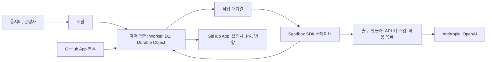

# 소프트웨어 팩토리 플랫폼 설계

작성일: 2026-11-06. 상태: 1-2단계 코드가 있고, 3단계(리뷰와 병합) 코드가 같은 날 추가되었다. 3단계는 2026-11-06에 공개 시험 저장소에서 실제로 실행했으며, 아직 확인하지 않은 항목은 `docs/operations.md`의 마지막 절에 있다. 4단계(포털과 인증) 코드가 같은 날 추가되었고 가짜 서비스로 시험했지만, 실제 GitHub OAuth 로그인은 OAuth App을 만든 뒤에야 확인할 수 있어 아직 해 보지 않았다. 5단계 이후는 아직 제안이며 사용자의 확인을 기다린다.

## 1. 목적

이 플랫폼은 여러 저장소의 이슈를 AI 에이전트가 계획, 구현, 리뷰, 배포까지 처리하게 한다. 일반 사용자는 GitHub로 로그인한 옵저버로서 이 과정을 직관적으로 이해하고, 격리된 샌드박스에서 직접 요청해 체험한다.

이 저장소는 코드를 처음부터 새로 쓴다. 이전 저장소는 `roboco-io/conveyor`로 이름을 바꾸어 예제 서비스로 남겼다. 이전 프로젝트의 규칙, 훅, 스킬, 코드는 가져오지 않으며 전역 사용자 설정과 플러그인은 그대로 둔다. 이전 구현은 참고 자료로만 볼 수 있다.

## 2. 사용자가 정한 요구사항

사용자가 2026-11-06까지 정한 내용은 다음과 같다.

- 일반 사용자는 GitHub 인증으로 로그인하고 제한된 권한의 옵저버가 된다.
- 플랫폼은 rovr처럼 중앙 서버로 여러 프로젝트를 관리한다.
- 옵저버 요청은 샌드박스에서 사람 승인 없이 실행된다.
- 실행 환경은 Cloudflare Sandbox SDK다.
- 에이전트는 Claude Code 또는 Agent SDK와 pi이며, 각자의 API 키를 쓴다. Codex는 쓰지 않는다.
- 모델은 작업 내용에 따라 고를 수 있다.
- 계정별 사용량은 사용 가능량의 50%까지로 제한한다. Claude가 50%에 도달하면 pi로 전환한다. 둘 다 월간 50%에 도달하면 데모 사용자에게 안내하고 팩토리 이슈를 등록한다. 2026-11-08 사용자가 전환 대상을 바꾸었다. Claude가 상한에 도달하면 pi 대신 Codex CLI와 OpenAI `gpt-6.1-terra`가 구현한다. 2026-11-09 사용자가 다시 바꾸었다. Codex 경로는 실서비스 시험에서 모델을 부르기 전에 실패했고(`CODEX_HOME` 디렉터리 없음), 이후 구현 엔진은 pi와 `gpt-6.1-terra`다. pi 설정은 코딩 에이전트 벤치마크(roboco-io/coding-agent-benchmark)의 EXP-057 조건을 따른다.
- conveyor는 별도 저장소의 관리 대상 프로젝트이며, 기존 URL은 유지하지 않아도 된다.
- 책 `roboco-io/the-software-factory`도 새 구조에 맞춰 개정한다.

## 3. 구조

제어 평면이 프로젝트, 이슈, 작업, 실행, 사용자, 사용량의 원본이다. Durable Object는 이슈마다 하나씩 두고 상태 전환을 직렬화한다. 여러 웹훅과 실행 결과가 동시에 들어와도 상태가 어긋나지 않게 하기 위해서다. 이전 구현은 GitHub 라벨을 상태 저장소로 썼는데, 라벨은 전환을 원자적으로 처리할 수 없고 화면을 만들기에도 불편했다. 이번에는 GitHub을 코드와 대화가 있는 곳으로만 쓴다.

컨테이너는 실행마다 새로 만들고, GitHub 토큰과 LLM API 키를 넣지 않는다. 체크아웃과 PR 생성은 제어 평면이 짧은 수명의 토큰을 범위를 좁혀 처리하고, LLM 호출은 출구 핸들러가 키를 주입한다. 에이전트가 인젝션 공격을 당해도 비밀을 얻지 못하게 하기 위해서다.

## 4. 흐름과 책임

한 이슈는 분류, 계획, 구현, 리뷰, 병합, 배포, 완료 검증의 순서로 진행한다. 각 단계의 결과는 구조화된 이벤트로 저장되며, 포털은 이 이벤트로 흐름과 판단 근거를 보여 준다. 구현과 리뷰는 기본적으로 서로 다른 엔진이 맡는다. 코드 변경의 병합 가능 여부는 에이전트가 아니라 프로그램이 위험 등급, 필수 체크, 리뷰 결과로 판정한다.

| 역할   | 조건               | 권한                                       |
| ------ | ------------------ | ------------------------------------------ |
| 익명   | 로그인 없음        | 소개와 공개 기록 재생                      |
| 옵저버 | GitHub 로그인      | 공개 프로젝트 열람, 샌드박스 요청(쿼터 안) |
| 운영자 | 관리자 목록에 있음 | 프로젝트 등록, 중지, 지시, 위험 변경 승인  |

옵저버 로그인은 사용자 식별에만 쓰며 GitHub 토큰을 저장하지 않는다. 옵저버 화면에는 에이전트 원문 로그와 비밀이 나타나지 않는다.

## 5. 예산

월 예산은 계정당 $50로 둔다. 2026-11-06 문서 조사에 따르면 Claude Max와 OpenAI Pro의 $100 구독에 월 $100 API 크레딧이 포함되고, 잔액을 읽는 공식 API는 찾지 못했다. 그래서 제어 평면이 호출별 사용량과 관리자 키의 사용 금액 API로 지출을 계산한다. 이 값은 추정치이며 청구 주기 경계에서 오차가 있다. 실행 전에 예상 비용을 예약하고, 출구 핸들러가 실행 중 상한을 넘는 호출을 막는다. Anthropic 전용 워크스페이스에는 지출 한도 $50을 안전장치로 건다.

두 계정이 모두 상한에 도달하면 새 실행을 멈추고, 포털에 안내를 표시하고, 청구 주기당 하나의 팩토리 이슈를 등록한다. 이 이슈는 예산을 쓰지 않도록 자동 처리 대상에서 뺀다. 한 엔진만 남으면 T0와 T1 변경은 다른 모델의 새 세션이 리뷰하고 그 사실을 표시한다. T2와 T3은 다른 엔진을 쓸 수 있을 때까지 기다린다.

## 6. 샌드박스 공개 조건

공개 입력을 승인 없이 실행하므로, 다음을 시험으로 확인하기 전에는 공개하지 않는다. 컨테이너에 비밀이 없고, 출구가 `Outbound` 코드의 호스트, 메서드, 경로 허용 목록으로 막히며, 다른 트래픽이 차단되고, DNS 이름 조회로 외부에 데이터가 나가지 않으며, 샌드박스 저장소에 다른 프로젝트 권한이나 프로덕션 연결이 없고, 계정별 및 전체 쿼터와 전체 중지가 동작해야 한다. 악용 신고와 신규 계정 제한, 그리고 공개 자동 실행이 GitHub과 LLM 제공자 정책에 맞는지는 공개 전에 사람이 확인한다.

## 7. 구현 순서

먼저 위험한 가정을 실험으로 확인한다. 그 뒤 얇은 전체 경로를 만들고, 기능은 그 위에 더한다.

| 단계                 | 내용                                                                           | 완료 조건                                                                                                                                                                                                |
| -------------------- | ------------------------------------------------------------------------------ | -------------------------------------------------------------------------------------------------------------------------------------------------------------------------------------------------------- |
| 0. 실험              | Sandbox SDK에서 Claude와 pi 실행, 출구 제한, 키 주입, 실행 시간과 동시 실행 수 | 2026-11-06 실행함. 결과는 `experiments/sandbox-spike/RESULTS.md`에 있고, 미해결 항목은 8절에 적었다                                                                                                      |
| 1. 저장소 기반       | 새 AGENTS.md, 모노레포, CI, 배포                                               | 빈 포털과 Worker가 프로덕션에 배포된다                                                                                                                                                                   |
| 2. 한 이슈 전체 경로 | 시험 저장소에서 이슈 → 구현 → PR까지, 이벤트 저장                              | 실제 이슈 하나가 PR이 된다                                                                                                                                                                               |
| 3. 리뷰와 병합       | 교차 리뷰, 위험 등급, 필수 체크, 사람 승인                                     | T0는 자동 병합되고 T3은 승인을 기다린다. 2026-11-06 시험 저장소에서 T0 자동 병합, 리뷰어의 변경 요청 차단, 운영자 승인 뒤 병합, T3 승인 대기를 실서비스로 확인했다                                       |
| 4. 포털과 인증       | OAuth, 역할, 프로젝트, 흐름, 재생                                              | 옵저버가 쓰기 작업을 할 수 없음을 API 시험이 증명한다. 2026-11-06 실제 GitHub 로그인과 운영자 중지를, 2026-11-08 운영자가 아닌 계정의 중지 요청이 403으로 거부됨을 실서비스로 확인했다                   |
| 5. 예산과 전환       | 지출 계산, 전환, 안내, 이슈 등록                                               | 전환과 소진을 가짜 사용량으로 시험한다. 2026-11-09 상한을 잠시 낮춰 pi와 `gpt-6.1-terra`의 예비 구현과 단일 엔진 리뷰, 자동 병합을 실서비스로 확인했다. 두 계정 소진 경로는 실서비스에서 확인하지 않았다 |
| 6. conveyor 이전     | conveyor를 프로젝트로 등록하고 배포, 완료 검증                                 | 실제 기능 이슈가 프로덕션까지 간다. 2026-11-09 conveyor 이슈 #141이 PR #142(T1)로 자동 병합되어 conveyor 프로덕션에 배포되었다                                                                           |
| 7. 샌드박스 공개     | 6절의 조건을 시험하고 공개                                                     | 인젝션 시험 통과 뒤 사람이 공개를 승인한다                                                                                                                                                               |
| 8. 책 개정           | 새 구조에 맞춰 책을 고친다                                                     | 설명과 링크가 실제와 일치하고 사람이 검토한다                                                                                                                                                            |

### 3단계 구현 상태

3단계는 4절의 원칙을 다음과 같이 구현한다. PR이 열리면 구현과 다른 엔진(pi와 OpenAI의 `gpt-5.4-nano`, 변수 `REVIEW_MODEL`)이 새 샌드박스에서 읽기 전용으로 리뷰하고, 제어 평면이 리뷰 결과를 PR에 남긴다. 병합 여부는 프로그램이 대상 저장소 기본 브랜치의 `.factory/policy.yml`(위험 등급 규칙, 필수 체크, 자동 병합 등급)과 GitHub의 체크 실행, 운영자의 PR 승인으로 판정한다. T0는 조건이 맞으면 자동으로 병합되고, T3은 정책 파일이 허용해도 자동 병합하지 않으며 사람의 승인을 기다린다. `.github/`와 `.factory/` 아래 파일은 정책 규칙과 관계없이 최소 T3이다. 리뷰어가 변경을 요청하거나 결과가 유효하지 않으면 자동 수정 반복 없이 사람에게 넘긴다. 5절의 "한 엔진만 남은 경우"의 전환 규칙은 5단계에서 구현하므로 이번 단계에는 없다. 상세한 상태 전환, 사유 코드, 시간 제한은 `docs/operations.md`의 "리뷰와 병합 (3단계)" 절에 있다. 정책 파일 예시는 `docs/examples/factory-policy.yml`이다.

### 콘솔 구현 상태

4단계 위에 운영자용 콘솔 기능이 추가되었다. 코드와 가짜 서비스 시험은 있으나 실제 서비스에서는 확인하지 않았다. 확인하지 않은 항목은 `docs/operations.md`의 "콘솔: 승인, 비용 (4단계 이후)" 절에 있다.

첫째, 운영자는 `awaiting_approval` 상태의 실행을 포털에서 승인하거나 수정 요청할 수 있다. 이 리뷰는 팩토리의 GitHub App이 아니라 운영자 본인의 GitHub 계정으로 PR에 남는다. 그래서 승인 때 운영자는 GitHub에 다시 로그인하고, 기존 OAuth App에 `public_repo` 권한 범위를 허용해야 한다. 이 범위는 승인 흐름에서만 요청하며 일반 로그인은 계속 권한 범위를 요청하지 않는다. 사용자 토큰은 그 요청 하나의 변수 안에서만 쓰고 저장하지 않으며, 로그와 응답에도 남기지 않는다. 병합 판정은 `decision.ts`가 그대로 맡는다. 콘솔은 판정을 바꾸지 않고, 남긴 리뷰가 GitHub을 거쳐 판정에 반영된다. `public_repo`는 공개 저장소만 다루므로 비공개 저장소의 실행은 승인에 실패한다.

둘째, 모델 호출의 토큰 수를 출구 핸들러가 응답 스트림에서 읽어 단계(구현 또는 리뷰), 모델별로 D1에 기록한다. 기록이 실패해도 모델 응답은 바꾸지 않는다. 포털은 실행과 프로젝트의 비용을 달러로 보여 준다. 단가는 2026-11-07에 모델 공급사 문서에서 읽어 코드에 고정했으며(100만 토큰당 달러), 단가가 없는 모델이 하나라도 있으면 합계를 보이지 않고 "알 수 없음"으로 표시한다. 이것은 측정과 표시일 뿐이며, 5절의 예산 한도, 예약, 엔진 전환은 아래 "5단계 구현 상태"에서 이 기록을 재사용해 구현한다.

### 4단계 구현 상태

4단계는 4절의 역할 표 가운데 익명, 옵저버, 운영자의 구분과 운영자의 "중지"를 구현한다. 중지는 요청이며 실행을 맡은 Durable Object의 알람이 다음 확인 때 적용한다. PR이 만들어지기 전에 요청이 적용되면 실행은 `failed`로, 만들어진 뒤라면 `needs_human`으로 끝나며 사유 코드는 둘 다 `stopped_by_operator`다. 일반 로그인은 권한 범위(scope)를 요청하지 않는 GitHub OAuth App으로 하며, 사용자의 숫자 ID와 로그인 이름만 서명된 쿠키에 담고 GitHub 토큰은 저장하지 않는다. 역할은 요청마다 숫자 ID와 `OPERATOR_IDS`를 비교해 계산하므로 쿠키에는 없다. API는 경로 표 한 곳에 메서드와 최소 역할을 선언하고 분배 코드가 이를 강제하며, 쓰기 API는 실행 중지 하나뿐이었다. 이후 콘솔 기능이 승인 시작 API를 하나 더했다. 시험이 모든 쓰기 경로가 익명과 옵저버를 거부함을 증명한다. 포털은 소개, 프로젝트, 실행 흐름과 재생, 로그인 상태를 한국어로 보여 준다. 4절 표의 "샌드박스 요청", "프로젝트 등록", "지시", "위험 변경 승인"은 이 단계에 없으며 각각 7단계와 후속 단계의 몫이다. 설정 방법과 확인하지 못한 항목은 `docs/operations.md`의 "포털과 로그인 (4단계)" 절에 있다.

### 5단계 구현 상태

5단계는 5절의 예산 규칙을 다음과 같이 구현한다. 코드와 가짜 사용량 시험이 있다. 실서비스에서는 2026-11-09에 Anthropic 상한을 잠시 낮춰 예비 구현 경로를 확인했다(시험 저장소 실행 `01c905569fd1`). 두 계정이 모두 소진된 경우, `awaiting_engine` 대기, 소진 이슈 등록은 실서비스에서 확인하지 않았다. 설정, 상태, 확인하지 못한 항목은 `docs/operations.md`의 "예산과 엔진 전환 (5단계)" 절에 있다.

지출은 콘솔 기능이 이미 D1의 `run_usage` 표에 호출마다 기록하는 토큰 수를 재사용해 계산한다. 청구 주기는 UTC 달력 월이고, 계정별 지출은 그 달의 기록을 모델별로 합한 뒤 `pricing.ts`의 고정 단가를 곱한 추정치다. 단가표의 모델마다 공급사(Anthropic 또는 OpenAI)를 적어 두었으므로 모델 이름으로 계정을 정한다. 단가가 없는 모델의 호출은 금액을 셀 수 없으므로 출구 핸들러가 거부한다. 청구 주기 안에 단가 없는 모델의 기록이 하나라도 있으면 두 계정의 지출을 모두 알 수 없는 것으로 보고 그 달의 실행을 멈추므로, 단가표의 항목은 지우지 않는다. 성공한 응답에서 사용량을 읽지 못하면 입력 100,000토큰과 출력 16,000토큰을 쓴 것으로 기록하고, 기록이 실패하면 한 번 더 쓴다. 실패한 응답은 기록하지 않으므로, 이 추정은 실제 청구액보다 작을 수 있다. 관리자 키의 사용 금액 API는 아직 쓰지 않는다.

실행 하나의 지출에도 서버 상한을 둔다(기본 $5). 상한은 실행의 단계(구현, 리뷰)마다 따로 센다. 같은 계정의 다른 모델이 리뷰하는 경우에도 구현이 쓴 금액이 리뷰 몫을 없애지 않게 하기 위해서다. 그래서 실행 하나는 최대 상한의 두 배까지 쓸 수 있다. 월 상한만 두면 사후 집계의 특성상 실행 하나가 남은 예산을 모두 쓸 수 있기 때문에 이 상한이 필요하다. 출구 핸들러는 모델 호출을 공급사로 보내기 전에 이 단계의 지출과 해당 계정의 월 지출을 읽어, 실행 상한이나 월 상한에 도달했으면 402로 거부한다. 지출을 읽지 못하면 503으로 거부한다. 지출은 응답이 끝난 뒤에 기록되므로, 동시에 보낸 호출은 모두 같은 지출을 보고 통과할 수 있다. 그래서 실행 하나가 동시에 진행할 수 있는 모델 호출을 4개로 제한하고(D1의 `run_inflight`), 넘으면 429로 거부한다. 초과분은 최대 호출 4개의 비용이다. 에이전트가 거부를 받아 0이 아닌 코드로 끝나면 실행은 `budget_exceeded`로 끝난다. 거부를 받고도 에이전트가 정상 종료하면 일반 경로(게시 또는 리뷰 판정)로 진행한다.

새 실행은 계정에 "남은 예산 − 진행 중인 실행들이 예약한 금액 ≥ 실행 상한"이 성립할 때만 그 계정의 엔진으로 시작한다. 진행 중인 실행은 현재 단계가 쓰는 계정에 대해 실행 상한에서 이미 쓴 금액을 뺀 만큼을 예약한 것으로 본다. Anthropic에 여유가 있으면 Claude Code가, 없으면 pi 1.5.0과 `gpt-6.1-terra`가 구현한다. pi 설정은 벤치마크 EXP-057과 같다. 사고 수준은 `medium`이고, 시스템 프롬프트 뒤에 "Autonomy and persistence" 지시를 덧붙인다. pi 기본 프롬프트에는 자율 진행 지시가 없어서, 이 지시가 없으면 작업 한 부분을 마친 뒤 턴을 끝낸다. 도구는 read, bash, edit, write만 쓰고, 저장소의 AGENTS.md, 스킬, 확장, 프롬프트 템플릿, 프로젝트 설정과 MCP는 읽지 않는다. 남은 예산이 실행 상한보다 적은 계정은 "상한에 도달"한 것으로 본다. 두 계정이 모두 상한에 도달하면 새 실행을 시작하지 않고(웹훅 응답 `budget_exhausted`), 포털 상단에 안내를 표시하고, 이 저장소에 청구 주기마다 하나의 이슈를 GitHub App으로 등록한다. 이 저장소는 `PROJECTS`에 없으므로 이 이슈는 자동 처리 대상이 아니다. 예약 때문에만 시작할 수 없는 경우는 소진이 아니므로 `budget_reserved`로 거절하고 이슈를 등록하지 않는다.

리뷰 엔진은 리뷰를 시작할 수 있는 시점의 예산으로 한 번 정한다. 구현과 다른 계정에 여유가 있으면 그 계정의 모델이 리뷰한다(OpenAI는 pi와 `gpt-5.4-nano`, Anthropic은 pi와 `claude-haiku-5-5`). 구현한 계정만 남았으면 T0와 T1은 같은 계정의 다른 모델이 새 세션에서 리뷰하고, PR 리뷰 댓글에 단일 엔진 리뷰라고 적는다. T2, T3, 그리고 위험 등급을 모르는 PR은 새 상태 `awaiting_engine`에서 기다린다. 이 상태는 샌드박스를 쓰지 않고 동시 실행 수에도 세지 않으며, 1시간마다 예산을 다시 확인하고, 35일이 지나면 `engine_wait_timeout`으로 사람에게 넘긴다. 대기를 끝내고 리뷰를 시작하려면 리뷰 샌드박스가 필요하므로, 동시 실행 자리가 모두 차 있으면 5분 뒤에 다시 확인한다. 단일 엔진 리뷰 뒤에 기본 브랜치의 정책이 바뀌어 등급이 T2 이상이 되면 병합 판정은 사람에게 넘긴다.

## 8. 현재 상태와 영향

2026-11-09 확인 기준으로 상태는 다음과 같다. `roboco-io/conveyor`는 `PROJECTS`에 등록되어 있다(PR #18). conveyor 저장소의 레거시 Actions 팩토리(워크플로 14개, `packages/factory`, 예약 실행)와 이전 봇의 변수·비밀 값은 지웠고, 그 대신 이 플랫폼용 `.factory/policy.yml`과 `CODEOWNERS`를 두었다(conveyor PR #139, #140). conveyor의 웹은 `https://roboco.io/conveyor/`에서 200을 반환하고, 저장소 안의 옛 주소 링크도 고쳤다. 이전 주소 `https://roboco.io/the-software-factory-demo/`는 이제 이 저장소의 GitHub Pages 소개 페이지이며(`apps/site`), 예전 conveyor 링크는 브라우저 스크립트로 `/conveyor/`의 같은 위치로 넘긴다. 6단계 완료 조건도 확인했다. 2026-11-09 conveyor 이슈 #141(푸터 링크)이 팩토리를 거쳐 PR #142로 자동 병합되었고, conveyor 프로덕션 배포까지 성공했다.

0단계 실험에서 확인한 제약은 다음과 같다. 플랫폼은 Workers Paid 플랜을 전제로 한다. 에이전트 컨테이너는 `basic` 이상이어야 한다. `lite`에서는 Claude가 11분 동안 진행하지 못했다. 컨테이너 CA가 시스템 저장소에 없어 도구별 환경변수를 실행 때마다 넣어야 한다. 미해결 항목은 pi와 Claude 호출의 크레딧 차감 및 키와 크레딧 조직의 연결, 6개를 넘는 동시 실행과 10분을 넘는 작업, 비루트 실행이다. DNS 이름 조회의 외부 유출은 2026-11-10 실험(`experiments/dns-exfil/RESULTS.md`)에서 관측되지 않았다. 에이전트와 같은 구성(`enableInternet: false`와 HTTP, HTTPS 전체 가로채기)의 컨테이너에서 보낸 표식 이름 37개가 외부 DNS 로그에 하나도 남지 않았고, 같은 시각의 대조 조회는 기록되었다. 이 결과는 플랫폼 동작에 의존하므로, 7단계 공개 직전과 샌드박스 SDK, wrangler, 컨테이너 이미지의 판을 올릴 때 같은 실험을 다시 실행한다. 크레딧 차감은 5단계 전에 확인하려 했으나 확인하지 못한 채 5단계를 배포했다. 그래서 5단계의 지출은 호출별 토큰 사용량으로 계산한 추정치이고, 실제 청구와의 차이는 공급사 콘솔에서 따로 확인해야 한다.

## 9. 범위 밖

결제, 조직별 멀티 테넌트, 외부 사용자의 자체 저장소 등록, 옵저버의 실제 프로젝트 쓰기는 포함하지 않는다.

## 10. 결정이 필요한 것

포털 주소, conveyor 포럼 데이터의 이전 여부, 샌드박스의 첫 예제 앱, 샌드박스 하위 예산을 정해야 한다. 제안 기본값은 `factory.roboco.io`, 기존 D1 유지, 작은 정적 웹앱, 전체 하루 $5와 계정당 하루 2건이다. 이 값들은 실측 전 제안이다.
