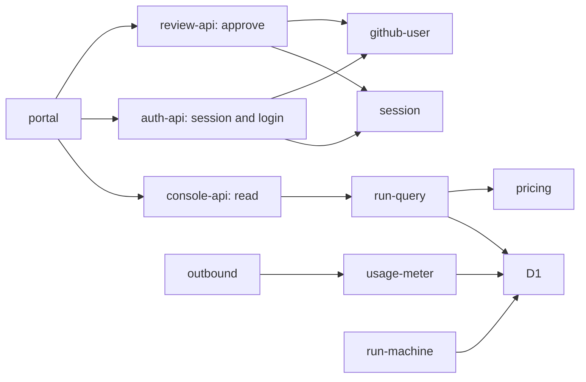
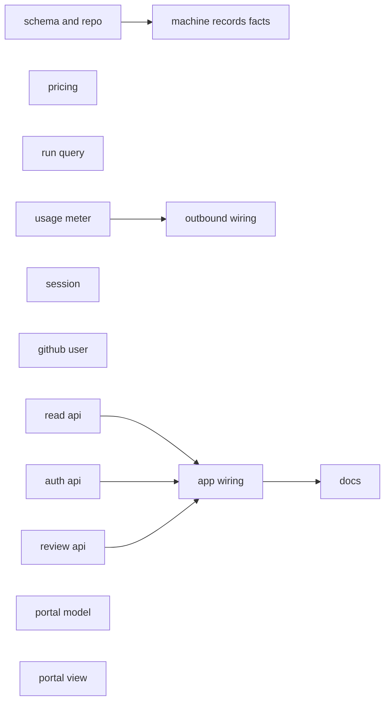
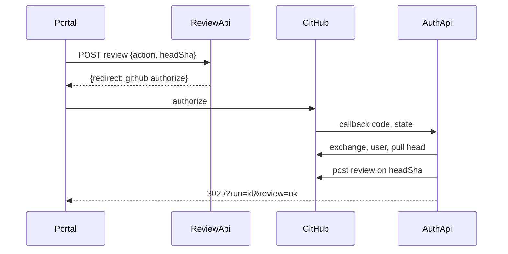

# Control console: machine plan

**Review plan:** docs/plans/2026-11-07-control-console.review.md
**Goal:** Replace the portal placeholder with a run console: public read API, GitHub login and roles, operator approval as a real GitHub review, estimated model cost per run.
**Architecture:** Cloudflare Worker `apps/control` (D1, Durable Objects), vanilla TS portal `apps/portal` built by Vite. New route modules return `Response | null`; `app.ts` chains them.
**Tech stack:** TypeScript, vitest, node:sqlite D1 fake (`src/testing/d1.ts`), happy-dom. Run all checks with `pnpm check` at the repo root. Test command for tasks: `pnpm --filter @factory/control test` or `pnpm --filter @factory/portal test`.
**Spec:** docs/plans/2026-11-07-control-console.review.md
**Detail:** contracts
**Target-min:** 25

## Global constraints

- Language: TypeScript, strict; tests first; test files sit next to the source as `*.test.ts`.
- Paths are relative to `apps/control/src` unless they start with `apps/` or `docs/`.
- Secrets never appear in code, logs, errors, commits or URLs we log. User tokens live only in one request's local variables and are never stored, logged or returned.
- Issue titles and all GitHub or agent content are data. The portal writes them with `textContent` only, never `innerHTML`.
- Merge decision code (`decision.ts`) does not change. The console only posts GitHub reviews.
- Events stay fixed-code. Titles live on `runs` only.
- Operators are matched by numeric GitHub id from `OPERATOR_IDS`, never by login.
- New settings: var `PUBLIC_REPOS` (default empty, meaning nothing is public), var `GITHUB_OAUTH_CLIENT_ID`, secrets `GITHUB_OAUTH_CLIENT_SECRET`, `SESSION_SECRET`.
- Prices (USD per million tokens, read 2026-11-07 from platform.claude.com and developers.openai.com): `claude-sonnet-5-5` input 2, output 10, cache read 0.10, cache write 2.50; `gpt-5.4-nano` input 0.20, output 1.25, cache read 0.02, cache write 0.20.
- Mockup for layout and colours: `/private/tmp/claude-501/-Users-dohyunjung--claude-spares-spare-li7OJR/8d4d4d98-10b1-4a27-b646-839a1ca8ac56/scratchpad/dash/project/Control.dc.html`.

## Main diagram

## File structure

- `apps/control/migrations/0004_console.sql`: new columns and `run_usage`.
- `d1-repo.ts`: run writes, adds facts and usage.
- `pricing.ts`: price table and cost.
- `run-query.ts`: read model for the console.
- `console-api.ts`: public read routes.
- `session.ts`: signed cookie, signed OAuth state, role.
- `github-user.ts`: GitHub calls with a user token.
- `auth-api.ts`: session, login, callback, logout routes.
- `review-api.ts`: approve and request-changes.
- `usage-meter.ts`: usage from a copy of the model response.
- `apps/portal/src/console-model.ts`: API client and view model.
- `apps/portal/src/console-view.ts`, `console.css`, `main.ts`: the screen.

## Task graph

```mermaid
%% schedule
gantt
  title Predicted schedule (mm:ss)
  dateFormat X
  axisFormat %M:%S
  section lane 1
  T13 portal view :t13, 0, 127s
  T15 docs :t15, 216, 94s
  section lane 2
  T4 run query :t4, 0, 114s
  section lane 3
  T12 portal model :t12, 0, 113s
  section lane 4
  T8 auth api :t8, 0, 111s
  T14 app wiring :t14, 111, 105s
  section lane 5
  T10 usage meter :t10, 0, 111s
  T11 outbound wiring :t11, 111, 100s
  section lane 6
  T9 review api :t9, 0, 109s
  section lane 7
  T6 session :t6, 0, 106s
  section lane 8
  T1 schema and repo :t1, 0, 104s
  T2 machine records facts :t2, 104, 98s
  section lane 9
  T7 github user :t7, 0, 104s
  section lane 10
  T5 read api :t5, 0, 101s
  T3 pricing :t3, 101, 93s
```

critical path: T8 → T14 → T15 (5.2 min) · peak width 10 · predicted build 5.2 min · predicted total ≈ 8.7 min (target ✓)

## Package: control read side

**Probe entry:** serve=apps.control.src.app.handleRequest

### T1 schema and repo · Complexity 3 (O-1) · Est. context 30k

**Owns:** apps/control/migrations/0004_console.sql, apps/control/src/d1-repo.ts, apps/control/src/d1-console.test.ts, apps/control/src/testing/machine-harness.ts
**Components:** 1
**LOC owned:** 110
**Tests:** fast
**Model:** sonnet
**Est. time:** 2 min
**Consumes:** none
**Produces:** RunRepo.recordFacts(f: { runId: string; tier?: string; headSha?: string }) -> Promise<void>
**Produces:** D1RunRepo.recordUsage(u: { runId: string; phase: string; model: string; inputTokens: number; outputTokens: number; cacheReadTokens: number; cacheWriteTokens: number; ts: number }) -> Promise<void>
**Review Focus:** `test_facts_keep_unset`: recordFacts with only tier leaves head_sha; `test_usage_requires_run`: unknown run id throws (foreign key).
**Test code (verbatim):** named tests: `createRun stores title` (title "Add footer" reads back); `createRun without title stores NULL`; `recordFacts updates tier and head_sha only` (updated_at unchanged, no new event); `recordUsage appends one row per call`; `migration keeps existing rows` (a run inserted before 0004 has title NULL).
**Steps:** 1 failing test, 2 run: FAIL, 3 implement, 4 run: PASS
**Notes:** 0004 adds `runs.title`, `runs.tier`, `runs.head_sha` (all TEXT NULL) and table `run_usage(id INTEGER PRIMARY KEY AUTOINCREMENT, run_id TEXT NOT NULL REFERENCES runs(id), phase TEXT NOT NULL, model TEXT NOT NULL, input_tokens, output_tokens, cache_read_tokens, cache_write_tokens INTEGER NOT NULL, ts INTEGER NOT NULL)` with index on run_id. `createRun` gains optional `title?: string`. Add `all<T>(): Promise<{ results: T[] }>` to the `Statement` interface. In the harness's fake repo add `recordFacts` that pushes to a `facts` array the harness returns.

### T2 machine records facts · Complexity 3 (O-1) · Est. context 40k

**Owns:** apps/control/src/run-machine.ts, apps/control/src/run-machine-console.test.ts, apps/control/src/d1-stage3.test.ts
**Components:** 1
**LOC owned:** 70
**Tests:** fast
**Model:** sonnet
**Est. time:** 2 min
**Consumes:** RunRepo.recordFacts(f: { runId: string; tier?: string; headSha?: string }) -> Promise<void> (T1)
**Produces:** none
**Review Focus:** `test_tier_written_once`: repeated polling with the same tier makes one recordFacts call.
**Test code (verbatim):** named tests: `createRun receives the issue title`; `headSha recorded when the PR is published`; `tier recorded after evaluate`; `tier change recorded again`; `recordFacts failure retries the step, it does not fail the run on the first error`.
**Steps:** 1 failing test, 2 run: FAIL, 3 implement, 4 run: PASS
**Notes:** Store the last written tier on `StoredRun` (`recordedTier`) and compare before writing. Call it inside `evaluate`'s caller, after `classifyPullRequest`. Do not change any transition. Existing run-machine tests must stay green.

### T3 pricing · Complexity 1 (O-1) · Est. context 22k

**Owns:** apps/control/src/pricing.ts, apps/control/src/pricing.test.ts
**Components:** 1
**LOC owned:** 60
**Tests:** fast
**Kind:** mechanical
**Model:** haiku
**Est. time:** 1.5 min
**Consumes:** none
**Produces:** pricing.costUsd(model: string, usage: { inputTokens: number; outputTokens: number; cacheReadTokens: number; cacheWriteTokens: number }) -> number | null
e.g. costUsd("gpt-5.4-nano", { inputTokens: 1000000, outputTokens: 1000000, cacheReadTokens: 0, cacheWriteTokens: 0 }) -> 1.45
e.g. costUsd("claude-sonnet-5-5", { inputTokens: 0, outputTokens: 0, cacheReadTokens: 1000000, cacheWriteTokens: 1000000 }) -> 2.6
e.g. costUsd("unknown-model", { inputTokens: 1, outputTokens: 1, cacheReadTokens: 0, cacheWriteTokens: 0 }) -> null
**Test code (verbatim):** named tests: the three e.g. lines above; `zero usage costs 0`.
**Steps:** 1 failing test, 2 run: FAIL, 3 implement, 4 run: PASS

### T4 run query · Complexity 5 (O-1) · Est. context 35k

**Owns:** apps/control/src/run-query.ts, apps/control/src/run-query.test.ts
**Components:** 1
**LOC owned:** 190
**Tests:** fast
**Model:** sonnet
**Est. time:** 3 min
**Consumes:** pricing.costUsd(model: string, usage: { inputTokens: number; outputTokens: number; cacheReadTokens: number; cacheWriteTokens: number }) -> number | null (T3)
**Produces:** run-query.bucketOf(state: string, updatedAt: number, now: number) -> "attention" | "active" | "done"
e.g. bucketOf("awaiting_approval", 0, 1000) -> "attention"
e.g. bucketOf("failed", 0, 8 * 86400000) -> "done"
e.g. bucketOf("reviewing", 0, 1000) -> "active"
**Produces:** run-query.listRuns(db: D1Like, opts: { publicRepos: string[]; now: number }) -> Promise<{ runs: RunSummary[]; totals: { attention: number; active: number; done: number; usd: number | null } }>
e.g. listRuns(db, { publicRepos: [], now: 1 }) -> { runs: [], totals: { attention: 0, active: 0, done: 0, usd: 0 } }
**Produces:** run-query.getRun(db: D1Like, id: string, opts: { publicRepos: string[]; now: number }) -> Promise<RunDetail | null>
e.g. getRun(db, "run-in-private-repo", { publicRepos: ["a/b"], now: 1 }) -> null
**Review Focus:** `test_private_repo_absent`: a run in a repo outside publicRepos appears in neither list nor totals nor getRun; `test_like_chars_not_matched`: publicRepos entry `a/%` matches nothing; `test_unknown_model_not_zero`: usage on an unpriced model gives cost.status "unknown" and totalUsd null.
**Test code (verbatim):** named tests: the e.g. lines; `awaiting_approval and needs_human and failed attention within 7 days`; `attention sorted first then newest`; `limit 100 newest`; `no usage rows gives status not_measured`; `implement and review costs split by phase`; `events oldest first`.
**Steps:** 1 failing test, 2 run: FAIL, 3 implement, 4 run: PASS
**Notes:** `RunSummary` = `{ id, repo, issueNumber, title: string|null, tier: string|null, state, reasonCode: string|null, prNumber: number|null, headSha: string|null, createdAt, updatedAt, bucket, cost: { status: "measured"|"not_measured"|"unknown", totalUsd: number|null, implementUsd: number|null, reviewUsd: number|null } }`. `RunDetail` adds `events: { ts, kind, fromState, toState, reasonCode }[]`. merged is always done; other non-terminal states are active; attention older than 7 days is done. Bind `repo IN (?, ?, ...)` with exact values. Empty publicRepos runs no query. A "review" phase row counts as review; every other phase as implement. `totals.usd` sums measured runs and is null if any run is "unknown".

### T5 read api · Complexity 3 (O-1) · Est. context 28k

**Owns:** apps/control/src/console-api.ts, apps/control/src/console-api.test.ts
**Components:** 1
**LOC owned:** 90
**Tests:** fast
**Model:** sonnet
**Est. time:** 2 min
**Consumes:** run-query.listRuns(db: D1Like, opts: { publicRepos: string[]; now: number }) -> Promise<{ runs: RunSummary[]; totals: { attention: number; active: number; done: number; usd: number | null } }> (T4) · run-query.getRun(db: D1Like, id: string, opts: { publicRepos: string[]; now: number }) -> Promise<RunDetail | null> (T4)
**Produces:** console-api.handleConsoleRead(request: Request, deps: { db: D1Like; publicRepos: string[]; now(): number }) -> Promise<Response | null>
e.g. GET /api/runs with no public repos -> 200 {"runs":[],"totals":{"attention":0,"active":0,"done":0,"usd":0}}
e.g. GET /api/runs/unknown -> 404 {"error":"not_found"}
e.g. GET /api/health -> null
**Review Focus:** `test_post_runs_405`: POST /api/runs gives 405 with allow GET, HEAD; `test_bad_id_404`: `/api/runs/a%2Fb` gives 404 without a query error.
**Test code (verbatim):** named tests: the e.g. lines; `responses are no-store json`; `POST /api/runs/x/review returns null` (it belongs to review-api).
**Steps:** 1 failing test, 2 run: FAIL, 3 implement, 4 run: PASS

## Package: login and approval

Security review required (auth). **Probe entry:** serve=apps.control.src.app.handleRequest

### T6 session · Complexity 5 (O-1) · Est. context 28k

**Owns:** apps/control/src/session.ts, apps/control/src/session.test.ts
**Components:** 1
**LOC owned:** 130
**Tests:** fast
**Model:** sonnet
**Est. time:** 2.5 min
**Consumes:** none
**Produces:** session.signToken(payload: object, secret: string, nowMs: number, ttlMs: number) -> Promise<string>
e.g. signToken({ a: 1 }, "s", 0, 1000) -> "<base64url>.<base64url>"
**Produces:** session.verifyToken(token: string | undefined, secret: string | undefined, nowMs: number) -> Promise<Record<string, unknown> | null>
e.g. verifyToken(expiredToken, "s", 2000) -> null
**Produces:** session.readUser(cookieHeader: string | null, secret: string | undefined, nowMs: number) -> Promise<{ id: string; login: string } | null>
e.g. readUser(null, "s", 0) -> null
**Produces:** session.roleOf(user: { id: string } | null, operatorIds: readonly string[]) -> "anonymous" | "observer" | "operator"
e.g. roleOf(null, ["1"]) -> "anonymous"
e.g. roleOf({ id: "2" }, ["1"]) -> "observer"
e.g. roleOf({ id: "1" }, ["1"]) -> "operator"
**Produces:** session.sessionCookie(value: string, maxAgeSeconds: number) -> string
e.g. sessionCookie("v", 28800) -> "factory_session=v; Path=/; HttpOnly; Secure; SameSite=Lax; Max-Age=28800"
**Review Focus:** `test_tampered_payload_null`, `test_wrong_secret_null`, `test_missing_secret_null`, `test_alg_none_shape_null`: token with empty signature gives null; `test_login_cannot_grant_operator`: user `{id:"2",login:"operatorname"}` with operatorIds `["1"]` is observer.
**Test code (verbatim):** named tests: the e.g. lines; `round trip returns the payload`; `session lifetime 8 hours` is the caller's ttl.
**Steps:** 1 failing test, 2 run: FAIL, 3 implement, 4 run: PASS
**Notes:** HMAC-SHA256 with WebCrypto, verify with `crypto.subtle.verify`. Cookie name `factory_session`.

### T7 github user · Complexity 3 (O-1) · Est. context 28k

**Owns:** apps/control/src/github-user.ts, apps/control/src/github-user.test.ts
**Components:** 1
**LOC owned:** 110
**Tests:** fast
**Model:** sonnet
**Est. time:** 2 min
**Consumes:** none
**Produces:** github-user.createUserGitHub(config: { clientId: string; clientSecret: string; fetch?: typeof fetch }) -> UserGitHub
**Produces:** UserGitHub.exchangeCode(code: string) -> Promise<string>
e.g. exchangeCode("c") -> "user-token"
**Produces:** UserGitHub.getUser(token: string) -> Promise<{ id: string; login: string }>
e.g. getUser("user-token") -> { id: "3435720", login: "op" }
**Produces:** UserGitHub.getPullHead(token: string, repo: string, prNumber: number) -> Promise<{ headSha: string; open: boolean }>
e.g. getPullHead("user-token", "a/b", 7) -> { headSha: "abc", open: true }
**Produces:** UserGitHub.postReview(token: string, repo: string, prNumber: number, review: { commitId: string; event: "APPROVE" | "REQUEST_CHANGES"; body: string }) -> Promise<void>
e.g. postReview("user-token", "a/b", 7, { commitId: "abc", event: "APPROVE", body: "x" }) -> undefined
**Review Focus:** `test_errors_hide_token`: a failing call's error message contains neither token nor client secret; `test_exchange_error_body`: 200 with `{"error":"bad_verification_code"}` throws.
**Test code (verbatim):** named tests: the e.g. lines; `postReview sends commit_id and event`; `numeric id becomes string`.
**Steps:** 1 failing test, 2 run: FAIL, 3 implement, 4 run: PASS
**Notes:** Use `githubRequest` from `github-publisher.ts` for API calls. Token exchange is `POST https://github.com/login/oauth/access_token` with `accept: application/json`.

### T8 auth api · Complexity 6 (O-1) · Est. context 38k

**Owns:** apps/control/src/auth-api.ts, apps/control/src/auth-api.test.ts
**Components:** 1
**LOC owned:** 170
**Tests:** fast
**Model:** sonnet
**Est. time:** 3 min
**Consumes:** session.signToken(payload: object, secret: string, nowMs: number, ttlMs: number) -> Promise<string> (T6) · session.verifyToken(token: string | undefined, secret: string | undefined, nowMs: number) -> Promise<Record<string, unknown> | null> (T6) · session.readUser(cookieHeader: string | null, secret: string | undefined, nowMs: number) -> Promise<{ id: string; login: string } | null> (T6) · session.roleOf(user: { id: string } | null, operatorIds: readonly string[]) -> "anonymous" | "observer" | "operator" (T6) · session.sessionCookie(value: string, maxAgeSeconds: number) -> string (T6) · UserGitHub.exchangeCode(code: string) -> Promise<string> (T7) · UserGitHub.getUser(token: string) -> Promise<{ id: string; login: string }> (T7) · review-api.completeReview(deps: ReviewDeps, intent: { runId: string; action: "approve" | "request_changes"; headSha: string; userId: string }, token: string) -> Promise<"ok" | "stale" | "denied" | "failed"> (T9)
**Produces:** auth-api.handleAuth(request: Request, deps: AuthDeps) -> Promise<Response | null>
e.g. GET /api/session anonymous -> 200 {"role":"anonymous","login":null,"loginEnabled":true}
e.g. POST /api/auth/logout with a foreign Origin -> 403 {"error":"forbidden"}
e.g. GET /api/health -> null
**Review Focus:** `test_callback_state_tampered_400`; `test_callback_no_nonce_cookie_400`: state valid but `factory_oauth` cookie missing or different gives 400 and no GitHub call; `test_not_configured_503`: login with no client secret gives 503; `test_review_intent_other_user_denied`: state's userId differs from the token's user, completeReview is not called; `test_token_not_in_response`: no response header or body contains the token.
**Test code (verbatim):** named tests: the e.g. lines; `login redirects to github with client_id and state`; `callback sets session cookie and clears nonce`; `logout clears the cookie`; `session reports operator by numeric id`.
**Steps:** 1 failing test, 2 run: FAIL, 3 implement, 4 run: PASS
**Notes:** `AuthDeps` = `{ sessionSecret?: string; clientId?: string; operatorIds: string[]; github: Pick<UserGitHub, "exchangeCode" | "getUser">; review: ReviewDeps; now(): number; origin: string }`. Login state `{kind:"login",nonce}`, review state `{kind:"review",nonce,runId,action,headSha,userId}`, TTL 10 minutes; nonce also in a `factory_oauth` HttpOnly cookie. After the callback finishes, drop the token variable. Redirect only to `/` or `/?run=<id>&review=<result>` built from verified values, `encodeURIComponent`.

### T9 review api · Complexity 6 (O-1) · Est. context 35k

**Owns:** apps/control/src/review-api.ts, apps/control/src/review-api.test.ts
**Components:** 1
**LOC owned:** 150
**Tests:** fast
**Model:** sonnet
**Est. time:** 2.5 min
**Consumes:** run-query.getRun(db: D1Like, id: string, opts: { publicRepos: string[]; now: number }) -> Promise<RunDetail | null> (T4) · session.readUser(cookieHeader: string | null, secret: string | undefined, nowMs: number) -> Promise<{ id: string; login: string } | null> (T6) · session.roleOf(user: { id: string } | null, operatorIds: readonly string[]) -> "anonymous" | "observer" | "operator" (T6) · session.signToken(payload: object, secret: string, nowMs: number, ttlMs: number) -> Promise<string> (T6) · UserGitHub.getPullHead(token: string, repo: string, prNumber: number) -> Promise<{ headSha: string; open: boolean }> (T7) · UserGitHub.postReview(token: string, repo: string, prNumber: number, review: { commitId: string; event: "APPROVE" | "REQUEST_CHANGES"; body: string }) -> Promise<void> (T7)
**Produces:** review-api.handleReviewRequest(request: Request, deps: ReviewDeps) -> Promise<Response | null>
e.g. POST /api/runs/r1/review anonymous -> 401 {"error":"login_required"}
e.g. POST /api/runs/r1/review observer -> 403 {"error":"forbidden"}
e.g. POST /api/runs/r1/review operator, displayed head differs -> 409 {"error":"head_changed"}
e.g. POST /api/runs/r1/review operator, matching -> 200 {"redirect":"https://github.com/login/oauth/authorize?..."}
**Produces:** review-api.completeReview(deps: ReviewDeps, intent: { runId: string; action: "approve" | "request_changes"; headSha: string; userId: string }, token: string) -> Promise<"ok" | "stale" | "denied" | "failed">
e.g. completeReview(deps, intentWithMovedHead, "t") -> "stale"
e.g. completeReview(deps, goodIntent, "t") -> "ok"
**Review Focus:** `test_denied_no_github_call`: anonymous, observer, foreign Origin and missing JSON content type make no GitHub call; `test_operator_removed_denied`: userId no longer in operatorIds at completion gives "denied"; `test_private_repo_404`: a run outside publicRepos gives 404; `test_not_awaiting_approval_409`: state reviewing gives 409 not_awaiting_approval; `test_bad_action_400`.
**Test code (verbatim):** named tests: the e.g. lines; `approve posts APPROVE on the displayed commit`; `request_changes posts REQUEST_CHANGES with the fixed body`; `closed PR is stale`.
**Steps:** 1 failing test, 2 run: FAIL, 3 implement, 4 run: PASS
**Notes:** `ReviewDeps` = `{ db: D1Like; publicRepos: string[]; operatorIds: string[]; sessionSecret?: string; clientId?: string; github: Pick<UserGitHub, "getPullHead" | "postReview">; now(): number; origin: string }`. Require same Origin and `content-type: application/json`. Body `{action, headSha}`. Fixed bodies: approve `콘솔에서 운영자가 승인했습니다.`; request changes `콘솔에서 수정을 요청했습니다. 자세한 내용은 이 PR에 이어서 남깁니다.` No free text from the request reaches GitHub. `completeReview` re-reads the run and the live head with the user token.

## Package: usage

**Probe entry:** call=apps.control.src.usage-meter.parseUsage

### T10 usage meter · Complexity 6 (O-1) · Est. context 30k

**Owns:** apps/control/src/usage-meter.ts, apps/control/src/usage-meter.test.ts
**Components:** 1
**LOC owned:** 170
**Tests:** fast
**Model:** sonnet
**Est. time:** 3 min
**Consumes:** none
**Produces:** usage-meter.parseUsage(target: "anthropic" | "openai", stream: ReadableStream<Uint8Array>, contentType: string) -> Promise<Usage | null>
e.g. parseUsage("anthropic", sse(message_start input 10 cache_read 2 cache_creation 3, message_delta output 5), "text/event-stream") -> { inputTokens: 10, outputTokens: 5, cacheReadTokens: 2, cacheWriteTokens: 3 }
e.g. parseUsage("openai", sse(response.completed input_tokens 10 cached_tokens 4 output_tokens 5), "text/event-stream") -> { inputTokens: 6, outputTokens: 5, cacheReadTokens: 4, cacheWriteTokens: 0 }
e.g. parseUsage("openai", body("not json"), "application/json") -> null
**Produces:** usage-meter.meterResponse(response: Response, target: "anthropic" | "openai", onUsage: (u: Usage) -> Promise<void>) -> { response: Response; done: Promise<void> }
e.g. meterResponse(new Response("x"), "anthropic", f).response body -> "x"
**Review Focus:** `test_body_bytes_identical`: client bytes equal upstream bytes for a split multibyte SSE stream; `test_parser_throw_keeps_stream`: onUsage rejecting or malformed JSON leaves the client stream whole and `done` resolves; `test_upstream_error_passthrough`: status 429 is returned unmetered; `test_no_body_passthrough`; `test_line_cap`: a line over 1 MiB is dropped without buffering the stream.
**Test code (verbatim):** named tests: the e.g. lines; `json non-stream usage parsed`; `client cancel does not reject done`; `chunk boundaries inside a line`.
**Steps:** 1 failing test, 2 run: FAIL, 3 implement, 4 run: PASS
**Notes:** `Usage` = `{ inputTokens, outputTokens, cacheReadTokens, cacheWriteTokens }`. Use `body.tee()`, parse one branch line by line, keep only counters, and never log content. OpenAI `input_tokens` includes cached tokens, so subtract them. On parser failure cancel only the meter branch.

### T11 outbound wiring · Complexity 4 (O-1) · Est. context 35k

**Owns:** apps/control/src/outbound.ts, apps/control/src/agent-sandbox.ts, apps/control/src/issue-run.ts, apps/control/src/outbound-meter.test.ts, apps/control/src/agent-sandbox-runid.test.ts
**Components:** 1
**LOC owned:** 80
**Tests:** fast
**Model:** sonnet
**Est. time:** 2 min
**Consumes:** usage-meter.meterResponse(response: Response, target: "anthropic" | "openai", onUsage: (u: Usage) -> Promise<void>) -> { response: Response; done: Promise<void> } (T10) · D1RunRepo.recordUsage(u: { runId: string; phase: string; model: string; inputTokens: number; outputTokens: number; cacheReadTokens: number; cacheWriteTokens: number; ts: number }) -> Promise<void> (T1)
**Produces:** usage-meter wiring only
**Review Focus:** `test_no_run_id_unmetered`: props without runId return the upstream response as is; `test_record_failure_logged_only`: recordUsage rejecting logs the error kind and the response still arrives.
**Test code (verbatim):** named tests: `model response metered and recorded with phase and model`; `non-model traffic not metered`. Mock `cloudflare:workers` the way existing sandbox tests do.
**Steps:** 1 failing test, 2 run: FAIL, 3 implement, 4 run: PASS
**Notes:** `AgentSandbox.start` and `startReviewSandbox` take an optional third argument `runId`, stored in kv and passed to `Outbound` props. `issue-run.ts` passes it (`sandboxId` without the `-review` suffix). Use `this.ctx.waitUntil(done)`. The agent never supplies the run id.

## Package: portal

**Probe entry:** serve=apps.control.src.app.handleRequest

### T12 portal model · Complexity 4 (O-1) · Est. context 28k

**Owns:** apps/portal/src/console-model.ts, apps/portal/src/console-model.test.ts
**Components:** 1
**LOC owned:** 180
**Tests:** fast
**Model:** sonnet
**Est. time:** 3 min
**Consumes:** none
**Produces:** console-model.stageOf(state: string) -> number
e.g. stageOf("queued") -> 0
e.g. stageOf("awaiting_approval") -> 4
e.g. stageOf("merged") -> 5
**Produces:** console-model.explain(run: { state: string; reasonCode: string | null; tier: string | null }) -> string
e.g. explain({ state: "needs_human", reasonCode: "changes_requested", tier: "T2" }) -> "교차 리뷰가 변경을 요청해 자동 처리를 멈췄습니다."
e.g. explain({ state: "failed", reasonCode: "brand_new_code", tier: null }) -> "실행이 실패했습니다. 사유 코드: brand_new_code"
**Produces:** console-model.money(cost: { status: string; totalUsd: number | null }) -> string
e.g. money({ status: "not_measured", totalUsd: null }) -> "측정 전"
e.g. money({ status: "unknown", totalUsd: null }) -> "계산 불가"
e.g. money({ status: "measured", totalUsd: 0.47 }) -> "$0.47"
**Produces:** console-model.fetchConsole(fetchFn: typeof fetch) -> Promise<{ runs: RunSummary[]; totals: Totals; session: SessionView }>
e.g. fetchConsole(fake empty) -> { runs: [], totals: { attention: 0, active: 0, done: 0, usd: 0 }, session: { role: "anonymous", login: null, loginEnabled: false } }
**Review Focus:** `test_every_reason_code_explained`: each code in `run-types.ts` REASON_CODES (copy the list) has its own sentence; `test_fetch_error_rejects`: a 500 rejects.
**Test code (verbatim):** named tests: the e.g. lines; `sends review with action and headSha`; `sendReview 409 returns head_changed`; `ago formats minutes and hours`.
**Steps:** 1 failing test, 2 run: FAIL, 3 implement, 4 run: PASS
**Notes:** Stage names 대기, 구현, 리뷰, 체크, 승인, 종료. A stopped run (needs_human, failed) keeps a stage from its last transition event when detail is loaded, else 5. Add `fetchRun(fetchFn, id)`, `sendReview(fetchFn, id, action, headSha)`. API JSON matches T4's `RunSummary`.

### T13 portal view · Complexity 6 (O-1) · Est. context 40k

**Owns:** apps/portal/src/console-view.ts, apps/portal/src/console-view.test.ts, apps/portal/src/console.css, apps/portal/src/main.ts, apps/portal/src/home.ts, apps/portal/src/home.test.ts, apps/portal/index.html
**Components:** 1
**LOC owned:** 290
**Tests:** fast
**Model:** sonnet
**Est. time:** 4 min
**Consumes:** console-model.stageOf(state: string) -> number (T12) · console-model.explain(run: { state: string; reasonCode: string | null; tier: string | null }) -> string (T12) · console-model.money(cost: { status: string; totalUsd: number | null }) -> string (T12) · console-model.fetchConsole(fetchFn: typeof fetch) -> Promise<{ runs: RunSummary[]; totals: Totals; session: SessionView }> (T12)
**Produces:** console-view.mountConsole(root: HTMLElement, deps: { fetch: typeof fetch; setInterval: typeof setInterval }) -> Promise<void>
**Review Focus:** `test_title_is_text`: title `` creates no img element; `test_buttons_operator_only`: anonymous and observer see no approve button, and operator sees it only on awaiting_approval; `test_poll_failure_keeps_data`: a failed refresh keeps the rows and shows a stale notice; `test_empty_state`: no runs shows an explanation, not a blank page.
**Test code (verbatim):** named tests: `attention filter`, `four cards with totals`, `stage track has six segments and an aria label`, `selecting a row loads detail`, `refresh every 30 seconds`, `head_changed shows reload notice`, `missing title shows issue number only`.
**Steps:** 1 failing test, 2 run: FAIL, 3 implement, 4 run: PASS
**Notes:** Follow the mockup. Delete `home.ts` and `home.test.ts`. Layout: list and detail side by side at 960px and wider, stacked below, no horizontal scroll at 375px. Buttons are at least 44px high. The "예시 데이터" label from the mockup is removed.

## Package: integration

**Probe entry:** serve=apps.control.src.app.handleRequest

### T14 app wiring · Complexity 4 (O-1) · Est. context 35k

**Owns:** apps/control/src/app.ts, apps/control/src/app.test.ts, apps/control/src/env.ts, apps/control/wrangler.jsonc, apps/control/worker-configuration.d.ts
**Components:** 1
**LOC owned:** 120
**Tests:** fast
**Model:** sonnet
**Est. time:** 2.5 min
**Consumes:** console-api.handleConsoleRead(request: Request, deps: { db: D1Like; publicRepos: string[]; now(): number }) -> Promise<Response | null> (T5) · auth-api.handleAuth(request: Request, deps: AuthDeps) -> Promise<Response | null> (T8) · review-api.handleReviewRequest(request: Request, deps: ReviewDeps) -> Promise<Response | null> (T9) · github-user.createUserGitHub(config: { clientId: string; clientSecret: string; fetch?: typeof fetch }) -> UserGitHub (T7)
**Produces:** none
**Review Focus:** `test_no_env_nothing_public`: empty env gives empty runs and no 500; `test_observer_post_denied_end_to_end`: real SQL, signed observer cookie, POST review gives 403 and zero fetch calls; `test_private_run_absent_end_to_end`; `test_session_without_secret_anonymous`.
**Test code (verbatim):** named tests: `existing health and webhook routes unchanged`; `operator approve flow writes APPROVE on displayed sha with fake GitHub and operatorStanding counts it` (feed the captured review to `operatorStanding` from `decision.ts`).
**Steps:** 1 failing test, 2 run: FAIL, 3 implement, 4 run: PASS
**Notes:** Add `PUBLIC_REPOS: ""` and `GITHUB_OAUTH_CLIENT_ID: ""` to wrangler vars. Do not add any repository to `PUBLIC_REPOS`.

### T15 docs · Complexity 1 (O-1) · Est. context 25k

**Owns:** docs/design.md, docs/operations.md, AGENTS.md
**Components:** 1
**LOC owned:** 70
**Tests:** fast
**Kind:** mechanical
**Model:** haiku
**Est. time:** 1.5 min
**Consumes:** none
**Produces:** none
**Test code (verbatim):** named test: `pnpm format:check` passes on the three files.
**Steps:** 1 write, 2 run format check
**Notes:** In Korean. design.md: state that login and roles (stage 4 part) and usage measurement (stage 5 part) exist, and that budgets do not. operations.md: new settings, human steps (GitHub App callback URL `<origin>/api/auth/callback`, client secret, `SESSION_SECRET`, `PUBLIC_REPOS`, `wrangler d1 migrations apply`), prices and their read date, and what is unverified: user-token review permission on a real repository, and metering on real traffic. Use `-` for ranges.

## Review Focus

- Control read side: HTTP service; protocol, encoding, state. Risk: private repository leakage.
- Login and approval: auth; protocol, state; security review required (Opus). Risks: CSRF, forged state, token leakage, stale head.
- Usage: data pipeline; numeric, encoding, state. Risk: breaking the model stream.
- Portal: web UI; protocol via API, encoding. Risk: XSS through issue titles.

## Self-review

Coverage: every review plan part maps to T1-T15. No placeholders. Consumes match Produces. Edges are execution only.
