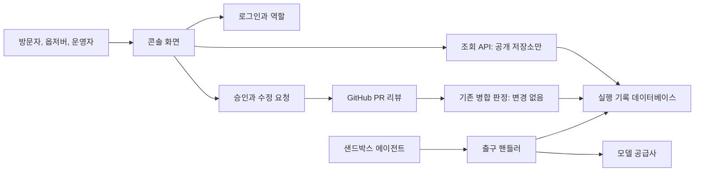
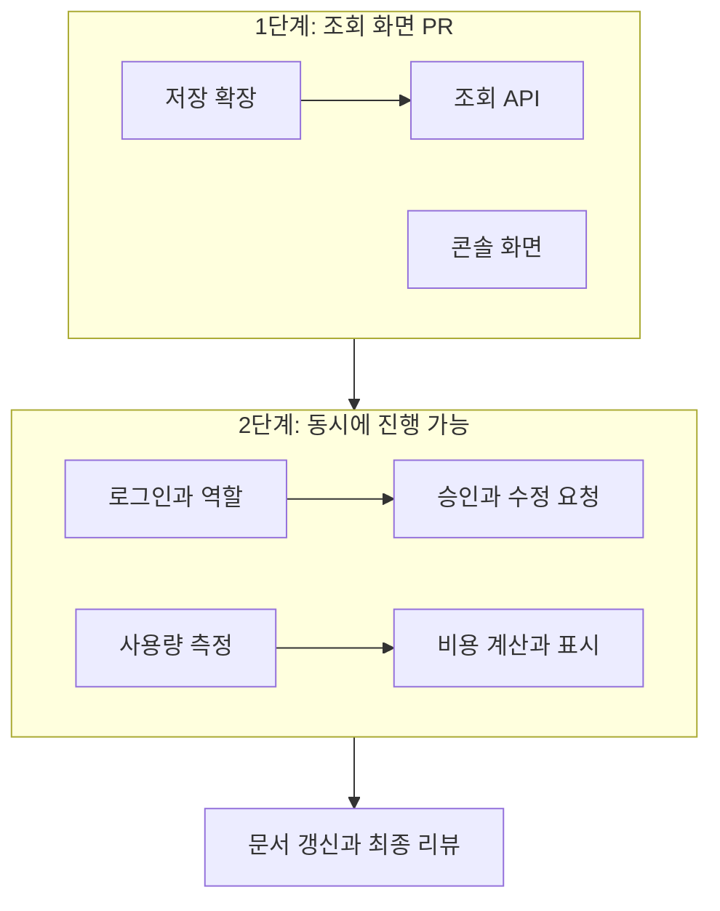

# 실행 현황 콘솔: 검토 계획

## Summary

포털의 "준비 중" 페이지를 실행 현황 콘솔로 바꾼다. 지금은 승인을 기다리는 변경이나 실패한 실행을 찾으려면 GitHub이나 데이터베이스를 직접 봐야 한다. 콘솔은 사람의 확인이 필요한 실행을 맨 위에 보여 주고, 멈춘 이유와 상태 기록을 같은 화면에 보여 준다. 운영자는 콘솔에서 승인하거나 수정을 요청할 수 있고, 모델 비용의 추정치도 볼 수 있다. 화면은 [확정한 목업](https://claude.ai/artifact/WbnYjDdPtVZYa1MhRqtQYy)의 "실행 현황 콘솔"을 따른다. 이 작업은 설계 문서의 4단계 일부(로그인, 역할)와 5단계 일부(사용량 측정)를 앞당긴다.

## What you will get

- 요약 카드 네 개(확인 필요, 진행 중, 병합 완료, 모델 비용 추정)와 단계별 건수가 있는 어두운 테마의 화면.
- 멈춘 이유와 현재 단계를 표시하는 실행 목록. 넓은 화면에서는 상세가 오른쪽에, 휴대전화 너비에서는 아래에 놓인다.
- 저장된 상태와 사유 코드로 만든 판단 근거 문장, PR 번호, 상태 기록, 구현과 리뷰의 추정 비용. 에이전트 원문 로그는 표시하지 않는다.
- GitHub 로그인. 익명 방문자와 옵저버는 읽기만 하고, 운영자만 승인과 수정 요청을 할 수 있다.
- 공개로 지정한 저장소만 보여 주는 설정. 기본값은 아무것도 공개하지 않는 것이다.
- PR 세 개로 나눈 변경: 조회 화면, 로그인과 승인, 비용 측정.

## What will be built

| 부분                | 하는 일                                                                                   | 크기 | 만드는 쪽     |
| ------------------- | ----------------------------------------------------------------------------------------- | ---- | ------------- |
| 실행 정보 저장 확장 | 이슈 제목, 위험 등급, 판정한 커밋을 실행 기록에 저장한다                                  | S    | 꼼꼼한 도우미 |
| 조회 API            | 공개로 지정한 저장소의 실행 목록과 상세를 읽기 전용으로 돌려준다                          | M    | 꼼꼼한 도우미 |
| 콘솔 화면           | 목업의 화면을 실제 데이터로 그리고 주기적으로 다시 읽는다                                 | M    | 꼼꼼한 도우미 |
| 로그인과 역할       | GitHub으로 사용자를 확인하고 숫자 ID로 운영자를 구분한다                                  | M    | 꼼꼼한 도우미 |
| 승인과 수정 요청    | 운영자 본인 이름의 GitHub 리뷰를 표시된 커밋에 남기고 인증 토큰을 바로 버린다             | M    | 꼼꼼한 도우미 |
| 사용량 측정         | 출구 핸들러가 응답 전달을 방해하지 않으면서 응답 사본에서 사용량을 읽어 실행별로 저장한다 | M    | 꼼꼼한 도우미 |
| 비용 계산과 표시    | 모델별 단가표로 금액을 추정해 API와 화면에 넘긴다                                         | S    | 빠른 도우미   |
| 문서 갱신           | 설계 문서의 단계 설명과 새 설정 항목을 실제와 맞춘다                                      | S    | 빠른 도우미   |

## How it fits together

승인은 새 경로를 만들지 않는다. 콘솔은 GitHub에 리뷰를 남기기만 하고, 병합 여부는 기존 판정이 GitHub의 최신 정보를 읽어 결정한다.

## How it gets built

조회 화면 PR을 먼저 만들면 로그인이나 비용 작업이 늦어져도 콘솔을 쓸 수 있다.

## Decisions you can change

- 화면에 없는 값: 비어 있으면 이슈 번호만 표시(기본) | 과거 실행을 GitHub에서 채움
- 멈춘 실행: 7일 후 최근 종료로 이동(결정함) | 계속 남김
- 공개 범위: 지정 저장소를 로그인 없이 공개(결정함) | 로그인한 사용자에게만 공개
- 비용 공개: 실행 정보와 같은 범위(기본) | 로그인한 사용자에게만
- 수정 요청의 내용: 정해진 문구를 남기고 자세한 내용은 GitHub에서 작성(기본) | 콘솔에서 내용을 직접 입력
- 화면 갱신: 30초마다 다시 읽음(기본) | 실시간 연결
- 커밋: 지금 브랜치의 교차 리뷰 작업 위에 새 브랜치를 만들고 부분마다 커밋(기본) | 숨은 체크포인트만 두고 나중에 정리

## Risks

- **출구 핸들러 고장:** 모든 모델 호출이 지나는 경로다. 응답 사본만 읽고, 사용량을 읽다 실패해도 응답이 끊기지 않는 것을 시험으로 증명한다. 이 부분과 로그인, 승인은 별도의 보안 리뷰를 받는다.
- **권한 오류:** 옵저버와 익명 사용자의 쓰기 요청, 위조된 요청, 다른 사이트에서 보낸 요청이 거부되는 것을 API 시험으로 증명한다.
- **잘못된 커밋 승인:** 화면을 본 뒤 커밋이 바뀌면 승인을 거부한다. 판정도 현재 커밋의 승인만 인정한다.
- **외부 입력의 표시:** 이슈 제목은 외부 입력이므로 텍스트로만 출력한다.
- **비공개 정보 노출:** 지정하지 않은 저장소의 데이터가 응답에 없음을 시험으로 증명한다.
- **비용 오차:** 금액은 청구액이 아닌 추정치이고 화면에도 그렇게 표시한다. 단가를 모르는 모델은 0원이 아니라 "계산 불가"로 표시한다.
- **아직 확인하지 못한 점:** GitHub App의 현재 권한으로 사용자 대리 리뷰가 가능한지 첫 구현에서 시험 저장소로 확인한다. 안 되면 권한 변경이 필요하므로 멈추고 묻는다.

## Out of scope

- 예산 상한, 비용 예약, 초과 시 실행 중지, 예산 이슈 등록(5단계에 남음).
- 프로젝트 등록, 실행 중지와 지시, 샌드박스 요청, 공개 기록 재생.
- 프로덕션 배포, 저장소 공개 설정 변경, 실서비스 비밀 값 입력. 이들은 사람이 따로 승인하고 수행한다. 로그인에 필요한 GitHub App 콜백 주소와 클라이언트 비밀 값도 사람이 설정한다.
- 과거 실행의 비용 복원. 측정 시작 전의 실행은 "측정 전"으로 표시한다.

## How we will know it works

- `pnpm check`가 통과한다.
- 공개 지정이 없으면 조회 API가 실행을 하나도 돌려주지 않는다.
- 옵저버와 익명 사용자의 승인 요청이 거부되고 GitHub에 아무 호출도 가지 않는다.
- 운영자 승인이 가짜 서비스 시험에서 표시된 커밋에 리뷰로 기록되고, 기존 판정이 이를 승인으로 계산한다.
- 시험 저장소에서 T3 변경을 콘솔로 승인하면 병합까지 진행된다. 이 확인은 설정을 마친 뒤 사람과 함께 수행한다.
- 스트리밍 응답이 측정 전과 같은 내용으로 도착하고, 비용이 실행별로 기록된다.
- 로컬에서 실제 화면을 데스크톱과 휴대전화 너비로 확인했을 때 목업과 같은 구성이 보인다.

## Rough time and cost

구현 도우미 기준으로 약 40-70분, $15-35로 예상한다. 구현 계획을 검사하기 전의 대략적인 값이다. 사람이 해야 하는 GitHub App 설정과 배포 승인에 드는 시간은 포함하지 않았다.
