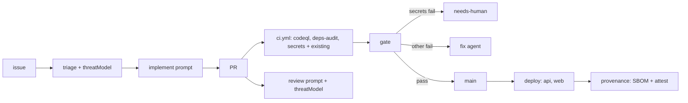
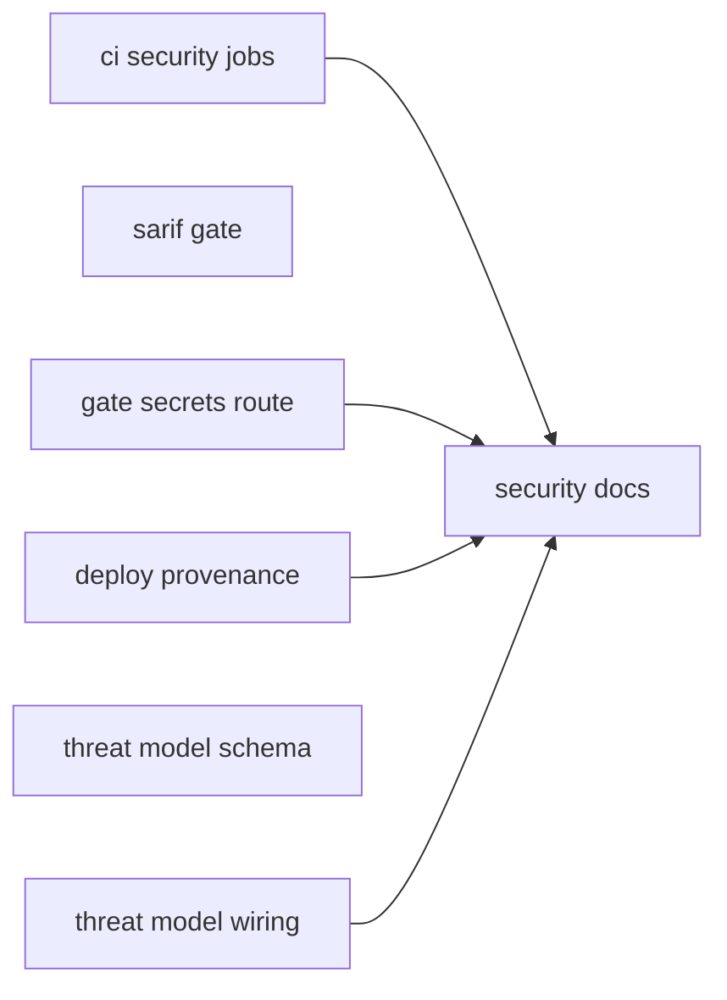

# SDLC Security Controls (design + plan)

**Goal:** Frame the factory as "security across the SDLC" (roboco.io/solutions: 의도 정의, 구현, 검증, 배포, 관찰과 개선) and close the gaps: SAST + dependency scan, secret scan, SBOM + build provenance, threat model at triage.
**Architecture:** New CI jobs become required checks through `factory/risk-policy.yml`; deploy gains a separate `provenance` job; triage emits a STRIDE threat model for T2+ issues that implement and review prompts consume; `docs/security.md` maps every control to its stage.
**Tech stack:** GitHub Actions, CodeQL, gitleaks CLI, pnpm audit, anchore/sbom-action, actions/attest-*, TypeScript + zod + vitest (`packages/factory`), node:test (`scripts/`).
**Spec:** this file, section 1.
**Detail:** contracts
**Target-min:** 11

## 1. Design

User decisions (2026-10-23): scope = document existing controls AND add new ones; controls = SAST·dependency scan, secret scan, SBOM·provenance, threat-model step; orchestrator = AI.

Facts (2026-10-23): repo is public; secret scanning, push protection, Dependabot security updates are on. No SAST/audit/SBOM/attestation in CI. Required checks = `ci.yml` job ids in `requiredChecks` (`workflows.test.ts`). Branch protection is set by hand.

1.1 **SAST (`codeql` job).** CodeQL `javascript-typescript`, `build-mode: none`, query suite `security-extended`, results uploaded to code scanning and written to `sarif-results/`. CodeQL's analyze step does not fail on findings, so `scripts/sarif-gate.mjs` fails the job when a result has security-severity >= 7.0, or has no severity and level `error`. Missing or unreadable SARIF fails closed (exit 2).
1.2 **Dependency scan (`deps-audit` job).** `pnpm audit --audit-level=high` over all dependencies. Dev dependencies run in CI next to factory secrets, so they are in scope. A new upstream advisory can fail unrelated PRs; the fix agent then gets the PR, and the documented escape is a T2 `auditConfig.ignoreGhsas` entry approved by a human.
1.3 **Secret scan (`secrets` job).** gitleaks CLI (pinned container image, not `gitleaks-action`, which needs a paid license for organizations) scans every commit in the PR range with `factory/security/gitleaks.toml` (default rules + allowlist for test fixtures). A leaked secret stays in pushed history, so the gate sends `secrets` failures to `needs-human` instead of the fix agent: rotation and history rewrite are human work.
1.4 **SBOM + provenance (`provenance` job in deploy.yml).** `api` deploys with `wrangler deploy --outdir dist-worker` and uploads that bundle; `web` uploads `apps/web/dist`. A new `provenance` job (needs api, web) builds an SPDX SBOM from the repo and attests build provenance and the SBOM for both artifacts. `factory-report` does not depend on it, so an attestation failure is visible but never raises a false production incident.
1.5 **Threat model (triage → implement → review).** `TriageSchema.threatModel = {assets: string[1..10], threats: [{category: STRIDE, threat, mitigation}][1..10]}`, required when `riskTier` is T2 or T3. The triage comment renders it; implement and review prompts get it as `{{threatModel}}`; review checks each mitigation is implemented or tested and reports misses with category `security`. Eval cases pin the prompt sentences.
1.6 **Docs.** `docs/security.md` maps the five stages to controls (existing + new) with file paths, and lists limits. `operations.md`, `SECURITY.md`, the factory design spec 6.4 and `CHANGELOG.md` link to it. Operator step (manual, deferred): add `codeql`, `deps-audit`, `secrets` to main branch protection.

Ruling: CodeQL over Semgrep (because it is free for public repos and native to code scanning).
Ruling: workflow steps read scripts/config from the PR head, not a base checkout (because `pull_request` already runs head's workflow file; `risk-tier` blocks agent PRs touching T3 paths).
Ruling: detail `contracts` (because most work is YAML and prompts; the one algorithm, sarif-gate, has exact examples).
Ruling: plan lives in `docs/superpowers/plans/` (repo convention), written in English for agents; public docs stay Korean.

## 2. Diagram

## 3. File structure

Each task's Owns line lists its files.

Global constraints: Node from `.nvmrc` (24), pnpm 10. Factory tests: `cd packages/factory && pnpm exec vitest run test/<file>`. Script tests: `node --test scripts/<file>.test.mjs`. Done = `pnpm format` then `pnpm typecheck && pnpm lint && pnpm test` green. Workflow setup steps copy the existing `typecheck` job (checkout@v7, pnpm/action-setup@v6, setup-node@v7 with `.nvmrc`). Pin third-party actions/images to an existing release tag (check with `gh api repos/<owner>/<repo>/releases/latest`). Markdown: no `~` ranges; no `**` closing right after punctuation followed by a letter. Comments and docs in Korean like the surrounding code.

## 4. Task graph

```mermaid
%% schedule
gantt
  title Predicted schedule (mm:ss)
  dateFormat X
  axisFormat %M:%S
  section lane 1
  T1 ci security jobs :t1, 0, 136s
  T7 security docs :t7, 136, 107s
  section lane 2
  T5 threat model schema :t5, 0, 130s
  section lane 3
  T6 threat model wiring :t6, 0, 129s
  section lane 4
  T4 deploy provenance :t4, 0, 104s
  section lane 5
  T2 sarif gate :t2, 0, 97s
  section lane 6
  T3 gate secrets route :t3, 0, 96s
```

critical path: T1 → T7 (4.1 min) · peak width 6 · predicted build 4.1 min · predicted total ≈ 7.6 min (target ✓)

## 5. Tasks

### T2 sarif gate · Complexity 2 (O-1) · Est. context 26k
**Owns:** scripts/sarif-gate.mjs, scripts/sarif-gate.test.mjs
**Components:** 1
**LOC owned:** 110
**Tests:** fast
**Kind:** mechanical
**Model:** haiku
**Est. time:** 1.5 min
**Consumes:** none
**Produces:** sarif-gate.blockingResults(sarif: object, threshold: number = 7.0) -> Array<{ruleId: string, file: string, line: number|null, severity: number|null}>
e.g. blockingResults({runs:[{tool:{driver:{rules:[{id:"js/sql-injection",properties:{"security-severity":"8.8"}}]}},results:[{ruleId:"js/sql-injection",level:"error",locations:[{physicalLocation:{artifactLocation:{uri:"apps/api/src/a.ts"},region:{startLine:3}}}]}]}]}) -> [{ruleId:"js/sql-injection",file:"apps/api/src/a.ts",line:3,severity:8.8}]
e.g. same with "security-severity":"5.0" and level "warning" -> []
e.g. rule without security-severity, level "error", no region -> [{ruleId, file, line:null, severity:null}]
**Review Focus:** encoding: `suppressed result is ignored` (result.suppressions non-empty -> []); `rule found via ruleIndex when ruleId missing`; `cli exits 2 when directory has no .sarif files`; `cli exits 2 on invalid JSON`; `cli exits 1 and prints "js/sql-injection apps/api/src/a.ts:3 8.8"`; `cli exits 0 and prints "sarif-gate: 0 blocking"`.
**Test code:** named tests above plus the three e.g. lines, in `scripts/sarif-gate.test.mjs` using node:test like `scripts/check-markdown.test.mjs`.
**Steps:** 1 failing tests, 2 run: FAIL, 3 implement, 4 run: PASS
**Notes:** CLI: `node scripts/sarif-gate.mjs <dir-or-file>`; dir reads every `*.sarif` recursively. Rules also come from `tool.extensions[].rules`. Export the function; run CLI only when invoked directly.

### T1 ci security jobs · Complexity 4 (O-1) · Est. context 40k
**Owns:** .github/workflows/ci.yml, factory/risk-policy.yml, factory/security/gitleaks.toml, packages/factory/test/ci-security.test.ts
**Components:** 2
**LOC owned:** 170
**Tests:** fast
**Model:** sonnet
**Est. time:** 3 min
**Consumes:** none
**Produces:** ci.yml jobs `codeql`, `deps-audit`, `secrets`; requiredChecks `[typecheck, lint, unit, forum-api, e2e, risk-tier, evidence, eval, codeql, deps-audit, secrets]`
**Review Focus:** state/protocol: `ci security jobs run on pull_request and push`; `requiredChecks lists codeql, deps-audit, secrets`; `codeql job has security-events: write, actions: read, contents: read and runs sarif-gate`; `secrets job checks out with fetch-depth 0 and persist-credentials false and uses factory/security/gitleaks.toml`; `no job uses gitleaks/gitleaks-action`; `deps-audit runs pnpm audit --audit-level=high`.
**Test code:** named tests above, parsing YAML like `packages/factory/test/workflows.test.ts`. Existing workflows.test must still pass.
**Steps:** 1 failing tests, 2 run: FAIL, 3 implement, 4 run: PASS
**Notes:** codeql runs `node scripts/sarif-gate.mjs sarif-results` (T2) after analyze. secrets range: PR `base.sha..head.sha`; push `event.before..sha` (all-zero before: HEAD only). gitleaks flags `--redact --exit-code 1`. gitleaks.toml: `[extend] useDefault = true` + allowlist only for paths with fake tokens today (find by running gitleaks via docker if available, else grep; say which). Korean comment in risk-policy above the list.

### T3 gate secrets route · Complexity 3 (O-1) · Est. context 34k
**Owns:** packages/factory/src/stages/gate.ts, packages/factory/test/gate.test.ts
**Components:** 1
**LOC owned:** 50
**Tests:** fast
**Model:** sonnet
**Est. time:** 2 min
**Consumes:** none
**Produces:** gate moves issue to needs-human with record reason `secrets` when `secrets` is failing
**Review Focus:** state: `failing secrets moves issue to needs-human and does not dispatch factory-fix`; `failing secrets plus unit still goes to needs-human`; `failing unit only still dispatches factory-fix with reason ci`; `risk-tier failure path unchanged`.
**Test code:** named tests above in gate.test.ts with its existing fakes.
**Steps:** 1 failing tests, 2 run: FAIL, 3 implement, 4 run: PASS
**Notes:** Message (Korean): PR 커밋 범위에서 시크릿이 발견되어 사람이 시크릿을 폐기하고 이력을 정리해야 한다. Check `gateRevert` too: if it sends failures to fix, apply the same rule; if it does not, leave it.

### T4 deploy provenance · Complexity 4 (O-1) · Est. context 36k
**Owns:** .github/workflows/deploy.yml, packages/factory/test/deploy-provenance.test.ts, .gitignore
**Components:** 1
**LOC owned:** 110
**Tests:** fast
**Model:** sonnet
**Est. time:** 2.5 min
**Consumes:** none
**Produces:** deploy.yml job `provenance`; artifacts `worker-bundle`, `web-dist`, `sbom`
**Review Focus:** state: `provenance needs api and web`; `provenance has id-token: write, attestations: write, contents: read`; `factory-report does not need provenance`; `api deploy uses --outdir dist-worker and uploads worker-bundle`; `web uploads web-dist before gh-pages publish`; `top-level permissions unchanged`.
**Test code:** named tests above in deploy-provenance.test.ts, YAML-parsing style of workflows.test.ts.
**Steps:** 1 failing tests, 2 run: FAIL, 3 implement, 4 run: PASS
**Notes:** Attest web as `web-dist.tgz` (`tar -czf` of the dist) and the worker bundle files. Use actions/attest-build-provenance and actions/attest-sbom; SBOM from anchore/sbom-action, `format: spdx-json`. Add `dist-worker/` to `.gitignore`.

### T5 threat model schema · Complexity 4 (O-1) · Est. context 38k
**Owns:** packages/factory/src/report/comments.ts, packages/factory/test/threat-model.test.ts, factory/prompts/triage.md
**Components:** 2
**LOC owned:** 130
**Tests:** fast
**Model:** sonnet
**Est. time:** 2.5 min
**Consumes:** none
**Produces:** comments.renderThreatModel(tm: ThreatModel | undefined) -> string
e.g. renderThreatModel({assets:["에이전트 토큰"],threats:[{category:"spoofing",threat:"다른 사람의 토큰으로 글을 쓴다",mitigation:"토큰 소유자를 확인한다"}]}) -> "보호 대상: 에이전트 토큰\n- [spoofing] 다른 사람의 토큰으로 글을 쓴다 → 대응: 토큰 소유자를 확인한다"
e.g. renderThreatModel(undefined) -> "(없음)"
**Produces:** comments.ThreatModelSchema (zod) and `Triage.threatModel?: ThreatModel`
**Review Focus:** encoding/state: `T2 triage without threatModel fails TriageSchema`; `T1 triage without threatModel passes`; `T3 triage with valid threatModel passes`; `unknown STRIDE category fails`; `renderTriageComment shows 위협 모델 section with pipes and newlines escaped`; `findTriage round-trips threatModel`.
**Test code:** named tests above plus both e.g. lines.
**Steps:** 1 failing tests, 2 run: FAIL, 3 implement, 4 run: PASS
**Notes:** STRIDE enum: spoofing, tampering, repudiation, information-disclosure, denial-of-service, elevation-of-privilege. Use superRefine for the T2/T3 rule. triage.md: add the field to the JSON shape and one rule: T2·T3이면 threatModel을 쓴다 (보호 대상, 위협, 대응). Escape comment text with the existing `cell`/`sanitize` helpers.

### T6 threat model wiring · Complexity 4 (O-1) · Est. context 44k
**Owns:** packages/factory/src/stages/review.ts, packages/factory/src/stages/implement.ts, packages/factory/src/agents/prompt.ts, factory/prompts/review.md, factory/prompts/implement.md, packages/factory/test/review.test.ts, packages/factory/test/implement.test.ts, factory/evals/threat-model-review/case.yml, factory/evals/threat-model-implement/case.yml
**Components:** 2
**LOC owned:** 120
**Tests:** fast
**Model:** sonnet
**Est. time:** 3 min
**Consumes:** comments.renderThreatModel(tm: ThreatModel | undefined) -> string (T5)
**Produces:** prompt var `threatModel` in review and implement prompts
**Review Focus:** encoding: `review prompt contains rendered threat model from triage comment`; `review prompt shows (없음) when triage lacks threatModel`; `implement prompt contains rendered threat model`; `threatModel var is comment-stripped like issueBody` (prompt.ts list).
**Test code:** named tests above in the owned test files; eval cases load via existing eval-case tests.
**Steps:** 1 failing tests, 2 run: FAIL, 3 implement, 4 run: PASS
**Notes:** review.md: new section `## 위협 모델` with `{{threatModel}}` and criterion: 위협 모델의 각 대응이 구현되었거나 테스트로 확인되는가. 빠진 대응은 category security로 지적한다. implement.md: 위협 모델의 대응을 구현하고 테스트로 확인한다. Eval cases: `kind: prompt-contains` with those exact sentences (see factory/evals/README.md).

### T7 security docs · Complexity 3 (O-1) · Est. context 40k
**Owns:** docs/security.md, docs/operations.md, SECURITY.md, docs/superpowers/specs/2026-10-11-software-factory-design.md, CHANGELOG.md
**Components:** 1
**LOC owned:** 140
**Tests:** fast
**Model:** sonnet
**Est. time:** 2.5 min
**Consumes:** none
**Produces:** docs/security.md
**Review Focus:** `pnpm lint` markdown check passes; every control row names a real file path; facts carry date 2026-10-23.
**Test code:** `pnpm lint` (check-markdown) is the test.
**Steps:** 1 write, 2 lint, 3 fix
**Notes:** Korean, narrative paragraphs per AGENTS.md/CLAUDE.md writing rules. security.md: one section per stage (의도 정의, 구현, 검증, 배포, 관찰과 개선): what control exists, file, which check/agent enforces, where a human decides; then limits (pnpm audit noise, attestation not verified at runtime, branch protection manual, repo-level secret scanning). operations.md 보안: operator steps (add three checks to branch protection; ignore an advisory via `auditConfig.ignoreGhsas` as T2; handle a secrets needs-human). SECURITY.md: link. Spec 6.4: new required checks. CHANGELOG: unreleased entry per `.agents/skills/project-changelog/SKILL.md`.

## 6. Review Focus

- CI workflows (T1, T4): app type CI config; categories protocol, state; risks: over-broad permissions, job skipped counts as pass, fail-open gates. Probe entry: run=pnpm --filter factory test
- sarif-gate (T2): CLI; encoding, file; risk: fail-open on missing input. Probe entry: run=node scripts/sarif-gate.mjs
- factory threat model (T5, T6): library; encoding, state; risk: markdown/prompt injection through threat text. Probe entry: call=packages/factory/src/report/comments.renderThreatModel

## 7. Self-review

Coverage 1.1→T1+T2, 1.2→T1, 1.3→T1+T3, 1.4→T4, 1.5→T5+T6, 1.6→T7. No shared files across parallel tasks. All T3 paths; merge needs CODEOWNER approval.
